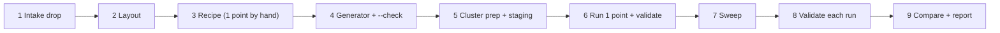
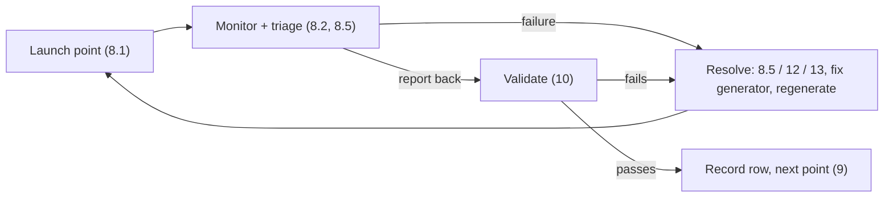

> Site-specific names, paths and addresses are replaced with `<placeholders>`.

# NVIDIA Slurm code drop → GKE sflow: the end-to-end guide

How to take an NVIDIA MLPerf-endpoints **Slurm** code drop, port every concurrency point
to **sflow on GKE (A4X-max / GB300 NVL72)**, prepare the cluster, run each point, and
deliver benchmark numbers that can be compared with NVIDIA's Slurm reference.

This is the **only** guide for this work. It has three parts, followed top to bottom by an
agent or a person for every new drop:

| Part | Covers | Sections |
|---|---|---|
| **Part 1 — Convert** | turn the NVIDIA Slurm recipes into GKE sflow recipes for every concurrency point | §3–§6 |
| **Part 2 — Prepare the cluster** | nodes, fabric, secrets, images, staging — ready to launch | §7 |
| **Part 3 — Run, monitor, resolve** | run each point one by one, keep monitoring, fix issues, validate, report | §8–§13 |

§0–§2 are read-first background; §14–§17 are reference.
Everything in it was hit for real on DeepSeek-R1 (v0.7 and v1.0.0), GPT-OSS-120B (v1.0.0)
and Kimi-K3 (v1.0.0). Nothing is hypothetical unless it says so.

---

## Contents

**Read first**

0. [How to use this guide](#0-how-to-use-this-guide)
1. [The core principle](#1-the-core-principle)
2. [Environment facts](#2-environment-facts)

**[Part 1 — Convert the Slurm code drop to GKE recipes](#part-1--convert-the-slurm-code-drop-to-gke-recipes)**

3. [Phase 1: intake the drop](#3-phase-1-intake-the-drop)
4. [Phase 2: repository layout](#4-phase-2-repository-layout)
5. [Phase 3: write the recipe](#5-phase-3-write-the-recipe)
6. [Phase 4: generator, check mode and reduced-node variants](#6-phase-4-generator-check-mode-and-reduced-node-variants)

**[Part 2 — Prepare the cluster](#part-2--prepare-the-cluster)**

7. [Phase 5: prepare the cluster](#7-phase-5-prepare-the-cluster)

**[Part 3 — Run each point, monitor, resolve issues](#part-3--run-each-point-monitor-resolve-issues)**

8. [Phase 6: run one point](#8-phase-6-run-one-point)
9. [Phase 7: sweep all points](#9-phase-7-sweep-all-points)
10. [Phase 8: validate every run](#10-phase-8-validate-every-run)
11. [Phase 9: compare with Slurm and report](#11-phase-9-compare-with-slurm-and-report)
12. [Node and cluster recovery runbook](#12-node-and-cluster-recovery-runbook)
13. [Failure catalogue](#13-failure-catalogue)

**[Reference](#reference)**

14. [sflow Kubernetes backend internals](#14-sflow-kubernetes-backend-internals)
15. [Reference results](#15-reference-results)
16. [Appendix A: sweep driver and summary extractor](#16-appendix-a-sweep-driver-and-summary-extractor)
17. [Appendix B: file index](#17-appendix-b-file-index)

---

## 0. How to use this guide

### 0.1 The phases



| Phase | Output | Done when |
|---|---|---|
| 1 Intake | per-point topology table, provenance notes, anomaly list | every point's `SLURM_NODES` matches your node math |
| 2 Layout | `<version>/<model>/<N>nodes/point_<C>/` skeleton + model README | tree matches [§4](#4-phase-2-repository-layout) |
| 3 Recipe | one hand-ported recipe for the smallest/simplest point | `sflow run --dry-run` prints `✓ Configuration is valid` |
| 4 Generator | `generate_point_recipes.py` emitting all points (+ variants) | `--check` passes, every point dry-runs |
| 5 Cluster | healthy nodes, secrets, images pulled, assets staged on **every** node | every stager pod prints `STAGED: node ready` |
| 6 First run | one validated result | all checks in [§10](#10-phase-8-validate-every-run) pass |
| 7 Sweep | `sflow_output/` in every point, `sweep/summary.tsv` | every row `OK` (or a documented failure) |
| 8 Validate | per-run check results | checks 1–13 pass or are explained |
| 9 Report | GKE vs Slurm table, deviations disclosed | numbers reviewed with the user |

### 0.2 Working rules (learned the hard way)

1. **Prepare everything before the first `launch_test.sh`.** A reservation of 12–18 nodes
   plus a 400 GB – 1.5 TB weight load is the expensive part; discovering a missing
   dataset, a bad image or a wrong venv after it is the most common way to waste hours.
   Recipes must fail fast *before* the reservation or at the first line of the benchmark.
2. **Validate with greps, not with the headline number.** Almost every failure in this
   port was *silent*: synthetic dataset fallback, drain under-count, lost reports, IMEX
   `DirectoryOrCreate`, a faulty fabric node that kubelet shows as Ready.
3. **Treat every fix's mechanism as a hypothesis and verify it.** Two recorded "fixes"
   (raising the collect grace period; disabling MNNVL to stop segfaults) addressed the
   wrong mechanism.
4. **Run points one at a time, in ascending concurrency, and monitor.** Keep staged
   assets and buckets between points. Don't rerun expensive points without a reason.
5. **Never inline secrets.** Tokens go in a Kubernetes Secret (`hf-token`) or
   `hf auth login` on the host, never in YAML, shell history or chat.
6. **Report in short tables, and end with a "Decision for you" when a choice is needed**
   (for example: rerun, cordon a node, accept a deviation).

---

## 1. The core principle

A Slurm benchmark recipe splits cleanly into two halves:

| | Where it comes from | What to do |
|---|---|---|
| **Model / workload** — parallelism, batch sizes, MoE backend, speculative decoding, KV config, concurrency, sample counts, drain/warmup/timeouts, accuracy datasets | The Slurm drop | **Copy verbatim.** This is NVIDIA's hardware tuning. Do not second-guess it. |
| **Fabric / container / launcher** — UCX, NCCL, RDMA, MPI, host mounts, node placement, result collection | *Not* from the Slurm drop | **Use the GKE compatibility layer** ([§5.6](#56-the-gke-compatibility-layer)). Model-independent, established empirically. |

> [!WARNING]
> **The #1 time sink is porting the second half from Slurm.** Those settings assume
> working RoCE/InfiniBand (`rc_x`, `mlx5_*`, `UCX_IB_GID_INDEX`,
> `UCX_CUDA_IPC_ENABLE_MNNVL=n`). On GKE they fail **silently**: healthy servers,
> zero errors, and up to **10x** less throughput.

The only overlaps are `cuda_graph_config` and node-local paths
([§5.4](#54-mandatory-edits)).

### 1.1 Slurm vs GKE, component by component

| Component | NVIDIA Slurm | GKE sflow (A4X-max / GB300) |
|---|---|---|
| Model storage | shared FS (`<workdir>/...`, Lustre/NFS) | node-local SSD `<node-local-ssd>/...`, staged on **every** node |
| Cross-node GPU fabric | RoCE/IB | Multi-Node NVLink (MNNVL) via NVIDIA `ComputeDomain` (`compute_domain: {create: true}`) — replaces Slurm `--segment=18` |
| KV-cache transfer (UCX) | RoCE RDMA, `UCX_CUDA_IPC_ENABLE_MNNVL=n` | NVLink IPC, `UCX_CUDA_IPC_ENABLE_MNNVL=y`, control over `tcp/eth0` |
| NCCL transport | RoCE net plugin (`libnccl-net.so`) | `rdma: disable`; all channels `P2P/MNNVL` |
| Control network | Slurm management interface | `host_network: true`, `eth0` |
| Processes | `srun` + Pyxis/Enroot | sflow tasks; `k8s_mpi` operator per role for TRT-LLM |
| Result files | shared FS | pod emptyDir → `kubectl cp` back to the workstation (+ durable node hostPath copy) |

---

## 2. Environment facts

Current values; confirm them at the start of each engagement (`kubectl config current-context`).

| Item | Value |
|---|---|
| kube context | `gke_<gcp-project>_us-central1_<cluster>` (zone `us-central1-b`) |
| GPU pool | `<nodepool>`, machine `a4x-maxgpu-4g-metal`, **arm64**, **4 GPUs/node**, 18 nodes when healthy |
| MIG (for recreate) | `<node>` |
| Local SSD | ~11 TB at `<node-local-ssd>` |
| Reservation | `nvidia-gb300-p4pq544ocuzz3`, block `…-block-0001`, sub-block `…-block-0001-subblock-0001` |
| Artifact Registry | `<registry>` |
| Bucket | `<bucket>` |
| sflow | `<workdir>/sflow_workspace/.venv` (**not on PATH**; launchers prepend `SFLOW_VENV`), v0.3.1.dev13 |
| Drops on disk | `<workdir>/code-drop-nvidia/<drop>/` — one folder per NVIDIA drop: `mlperf-endpoints-v0.7/`, `nv-mlpinf-partner-partner-endpoints-v1.0.0/`, `nv-mlpinf-partner-partner-endpoints-v1.0.1/`, … Generators default to these paths (`--slurm-root` overrides) |
| Other cluster seen | `<cluster>` (project `<cluster>`) |

Cluster constraints that shape everything below:

- **Workload Identity is off and node scopes are `devstorage.read_only`.** Pods can read
  GCS but not write it. HF → GCS transfers run on a VM, not in the cluster.
- **Everything is arm64**, including the CPU-only client/frontend pods. An amd64 image
  fails with `exec format error`.
- **No shared filesystem.** `fs://` artifacts are hostPath mounts.
- **Node index order is per run.** Which physical node is "node 0" changes between runs,
  so everything must be staged on every node of the pool.

---

# Part 1 — Convert the Slurm code drop to GKE recipes

Goal: one validated GKE recipe + `launch_test.sh` per concurrency point, generated from
the drop, passing `--check` and `--dry-run`. No cluster time is spent in this part.

## 3. Phase 1: intake the drop

### 3.1 Locate and inventory

Put every new drop under `<workdir>/code-drop-nvidia/<drop-name>/` (unpacked as delivered,
never edited). Drops so far have had three shapes. Identify which one you have:

| Shape | Example | Per-point files |
|---|---|---|
| TRT-LLM disagg, v0.7 | `code-drop-nvidia/mlperf-endpoints-v0.7/NVIDIA/src/configs/GB300-NVL72_GB300-288GB_aarch64x72_TRT/deepseek-r1/point_N/` | `dsr1_config.yaml`, `client.yaml`, `server-ctx.yaml`, `server-gen.yaml`, `server-env.yaml`, `slurm_env.yaml` |
| TRT-LLM disagg, v1.0.0 | `code-drop-nvidia/nv-mlpinf-partner-partner-endpoints-v1.0.0/NVIDIA/src/{deepseek_r1,gpt_oss_120b}/configs/GB300-NVL72_GB300-288GB_aarch64x72_TRT/point_N/` | `<model>_config.yaml` (`dsr1_config` / `gptoss_config`), `client.yaml`, `endpoint_env.yaml`, `server-ctx.yaml`, `server-gen.yaml`, `server-env.yaml` |
| SGLang IFB (+ SMG router) | `code-drop-nvidia/…-v1.0.0/NVIDIA/src/kimi-k3/configs/gb300-48gpu/point_{24,96,192}.yaml` | one YAML per point |

Also read the drop's top-level `README.md`, `dataset/`, and `NVIDIA/src/sflow/tools/`
(e.g. `generate_endpoint_yaml.py`, `setup_harmony_cache.sh`) — these tell you how the
Slurm side builds the client config and caches.

### 3.2 Build the per-point table

For every point record:

| Field | Source |
|---|---|
| ctx servers × TP, gen servers × TP (or TP/DP/EP for IFB) | `<model>_config.yaml` |
| frontends | `NUM_FRONTEND_SERVERS` |
| concurrency, `n_samples_to_issue` (or `num_trajectories_to_issue`), `max_new_tokens` | `client.yaml` |
| drain / warmup / `settings.timeouts` / `metrics_tokenizer_workers` | `client.yaml` |
| `max_batch_size`, `max_num_tokens`, `cuda_graph_config`, `speculative_config`, attention-DP, `free_gpu_memory_fraction` | `server-*.yaml` |
| model/runtime env | `server-env.yaml` |
| `SLURM_NODES`, `CLIENT_RESERVE_GPUS`, MODE, images | `slurm_env.yaml` / config |

Then compute nodes ([§5.3](#53-node-math-and-placement)) and assert they equal
`SLURM_NODES`. Put the asserted table in the generator as `EXPECTED` (the v1.0.0 DSR1
generator does this) so a changed drop fails loudly.

### 3.3 Record provenance (needed for every result)

- **Model repo + revision.** Pin a 40-char commit. v0.7 DSR1 used `DeepSeek-R1-NVFP4-v2`;
  v1.0.0 uses non-v2 `nvidia/DeepSeek-R1-NVFP4@4bedb8a6…` (80 shards,
  423,651,595,340 B). **Numbers across different checkpoints are not comparable.**
- **Client (endpoints) commit**, e.g. `e9f427c`, `cec2c28`.
- **Server image**, e.g. `nvcr.io/nvidia/tensorrt-llm/release:1.3.0rc14` (v1.0.0 certifies
  this; the proven v0.7 run used a dynamo image).
- **Dataset file + sha256.**
- **sflow version.**

### 3.4 Look for upstream anomalies — carry verbatim, flag, don't fix

Examples found so far:

- GPT-OSS `point_7168`: `model_params.name: openai/gpt-oss-120b` (likely a 404) and
  `report_dir: results`.
- Kimi `slurm_env.yaml` names `agentic_combined_v6.jsonl`; the real file is
  `mlperf_agentic_inference_dataset.jsonl` (same sha256).
- DSR1 v1.0.0 points 8192/16384/28080 set `CLIENT_RESERVE_GPUS: 8` → Slurm uses **20**
  nodes. GKE ports default to 18 (client on node 0, as in all validated runs) with a
  `CLIENT_RESERVE_NODES` knob.
- DSR1 v0.7 `point_256` was the only point with gen `cuda_graph_config: null` — stale,
  not intent ([§5.4](#54-mandatory-edits)).
- DSR1 v0.7 `point_8192` uses ctx `free_gpu_memory_fraction: 0.85`, not the `0.6` every
  other TP=2 point uses — a hand port would have got this wrong.

---

## 4. Phase 2: repository layout

Root: `<workdir>/self_contained/kubernetes/`.

```text
<version>/                       # v0.7, v1.0.0, ... (one folder per NVIDIA code drop)
  <model>/                       # deepseek-r1, gpt_oss_120b, kimi-k3, ...
    README.md                    # model-specific runbook (links back to this guide)
    generate_point_recipes.py    # emits every point folder; has --check
    recipe_base.yaml             # optional single-source template
    stage-assets.yaml            # staging DaemonSet (model + dataset, every node)
    mk-report-dir.yaml           # durable report hostPath DaemonSet
    prepull-images.yaml          # image prepull DaemonSet
    <N>nodes/                    # grouped by TOTAL node count of the topology
      point_<C>/
        <model>_gke_<...>_point<C>[_<N>nodes].yaml   # the recipe
        launch_test.sh
        sflow_output/            # run output of THIS point (gitignored)
          <run-id>/...
          launch-<UTC>.log
      sweep/                     # only if a sweep ran over this node group
        summary.tsv
        sweep-<UTC>.log
```

Rules:

- The Slurm topology lives in `<slurm_nodes>nodes/` (e.g. `18nodes/`). Reduced-node
  variants live in their own `<N>nodes/` group (`16nodes/`, `17nodes/`).
- Recipe and workflow names keep a `_<N>nodes` suffix for variants.
- `sflow_output/` is created by `launch_test.sh` running `sflow run` from the point
  folder. **Never pass `--output-dir` outside the point folder.**
- Relative links from a point file: `../../stage-assets.yaml` (model level),
  `../../../../SLURM_TO_GKE.md` (this guide).
- `sflow_output/` is gitignored. Decide with the user whether `sweep/` is committed.

---

## 5. Phase 3: write the recipe

Port **one** point by hand first — the smallest topology that exercises every role —
then generalise it in the generator ([§6](#6-phase-4-generator-check-mode-and-reduced-node-variants)).

Start from the most mature recipe for the serving stack:

| Stack | Start from |
|---|---|
| TRT-LLM disagg (v1.0.0 style, client.yaml as artifact) | [`gpt_oss_120b_gke_disagg_point1024.yaml`](v1.0.0/gpt_oss_120b/18nodes/point_1024/gpt_oss_120b_gke_disagg_point1024.yaml) / [`recipe_base.yaml`](v1.0.0/gpt_oss_120b/recipe_base.yaml) |
| TRT-LLM disagg (v0.7 style, placeholders) | [`gke_recipe_template.yaml`](gke_recipe_template.yaml), proven as [`deepseek_r1_gke_disagg_point256.yaml`](v0.7/deepseek-r1/18nodes/point_256/deepseek_r1_gke_disagg_point256.yaml) |
| SGLang IFB + SMG router | [`kimi_k3_gke_smg_point24.yaml`](v1.0.0/kimi-k3/12nodes/point_24/kimi_k3_gke_smg_point24.yaml) |

> [!IMPORTANT]
> Every TRT-LLM server task needs the **atomic** hang-detector patch, and every
> frontend needs the `GKE_PATCH missing:` checks ([§5.7](#57-runtime-patches-pinned-to-the-image--re-check-on-every-image-bump)).
> Both are in the DSR1 and GPT-OSS v1.0.0 generators (backported 2026-09-30; the
> recipes that produced the recorded results used the older in-place patch, which
> does not change any model/workload setting). v0.7 recipes are left as historical.

### 5.1 Extraction map (TRT-LLM disagg drops)

```text
<model>_config.yaml  ──► topology & server sizing → variables:
client.yaml          ──► VERBATIM as an artifact (v1.0.0) / placeholders (v0.7)
server-ctx.yaml      ──► VERBATIM as an artifact or heredoc (prefill)
server-gen.yaml      ──► VERBATIM (decode) — check cuda_graph_config
server-env.yaml      ──► model/runtime vars ONLY; discard every UCX_*/OMPI_*/IB/RoCE var
endpoint_env.yaml    ──► client runtime env (caches, HF paths); PATH handled separately
slurm_env.yaml       ──► discard; keep SLURM_NODES as a cross-check, note images/MODE
```

#### `<model>_config.yaml` → `variables:`

| Slurm variable | Recipe variable | Notes |
|---|---|---|
| `NUM_CTX_SERVERS` | `NUM_CTX_SERVERS` | prefill server count |
| `GPUS_PER_CTX_RANK` | `GPUS_PER_CTX_RANK` | GPUs per prefill server (its TP size) |
| `NUM_GEN_SERVERS` | `NUM_GEN_SERVERS` | decode server count |
| `GPUS_PER_GEN_RANK` | `GPUS_PER_GEN_RANK` | GPUs per decode server |
| `NUM_FRONTEND_SERVERS` | `NUM_FRONTEND_SERVERS` | usually 4 |
| `MODEL_PATH` | `MODEL_PATH` | **rewrite** to `<node-local-ssd>/model-cache/<model>`; update the `MODEL_CACHE` `fs://` artifact |

#### `client.yaml`

**v1.0.0 and later: emit the file verbatim as an artifact.** Synthesising it drops
`submission_ref`, the accuracy datasets and the drain/warmup/timeouts blocks. Only two
documented rewrites are allowed, and `--check` enforces exactly these:

1. `report_dir:` → `${REPORT_DIR}` (durable node hostPath, [§5.8](#58-the-benchmark-task-pattern)).
2. add `settings.metrics_tokenizer_workers: 32` (if the drop sets another value, record it).

The benchmark task then resolves only `endpoint_config.endpoints` from the frontend URL
list (port of NVIDIA's `generate_endpoint_yaml.py`); everything else round-trips.

**v0.7 (placeholder template):**

| Slurm field | Placeholder | Rule |
|---|---|---|
| `settings.load_pattern.target_concurrency` | `__CONCURRENCY__` | |
| `settings.runtime.n_samples_to_issue` | `__N_SAMPLES__` | **must stay large** (e.g. 21,940). `n_samples == concurrency` measures one ramp wave and read 15 % low (33.5k vs a 39.9k ceiling). |
| `model_params.max_new_tokens` | `__MAX_NEW_TOKENS__` | e.g. 20000 for DSR1 |
| `datasets[].path` basename | `__DATASET_FILE__` | e.g. `deepseek_r1_eval.parquet` |
| `settings.drain.*`, `settings.warmup.*` | emit verbatim | per point, see below |

#### `server-ctx.yaml` / `server-gen.yaml`

Verbatim — as file artifacts (v1.0.0; the task `cp`s them to `server-ctx.yaml`) or pasted
into heredocs indented 10 spaces (v0.7 template). They carry `tensor_parallel_size`,
`moe_expert_parallel_size`, `max_batch_size`, `max_num_tokens`, `max_seq_len`,
`kv_cache_config`, `moe_config`, `speculative_config`, `scheduler_config`,
`cache_transceiver_config`, attention-DP. Never retype them.

#### `server-env.yaml`

Keep **only the model/runtime keys that point actually sets**. Examples:

- DSR1: `TRTLLM_MOE_ENABLE_ALLTOALL_WITHOUT_ALLGATHER=1`, `TRTLLM_SERVER_DISABLE_GC=1`,
  `TRTLLM_WORKER_DISABLE_GC=1`, `TRTLLM_ENABLE_PDL=1`,
  `TRTLLM_GEMM_ALLREDUCE_FUSION_ENABLED=1`, `NCCL_GRAPH_MIXING_SUPPORT=0`,
  `TLLM_NUMA_AWARE_WORKER_AFFINITY=1`.
- GPT-OSS sets only `TRTLLM_MOE_ENABLE_ALLTOALL_WITHOUT_ALLGATHER`, `*_DISABLE_GC`,
  `PYTHONNOUSERSITE` — do **not** add the DSR1 extras.

Discard every `UCX_*`, `OMPI_*`, IB/RoCE variable.

### 5.2 drain / warmup / timeouts / salt — per point, per drop version

The client default `metrics_drain_timeout_s` is **60 s** with **2** tokenizer workers. At
high concurrency the aggregator cannot tokenize responses in time, hits the timeout, and
**drops still-queued samples from the token total while printing
`Total samples failed: 0`.** On v0.7 `point_8192` this dropped 56,531 of 350,886 samples
(16.1 %): reported **332,078 tok/s** for a run that really did ~395,900 (Slurm 408,369;
the fixed GKE rerun got **408,940**).

**v0.7** uses `settings.drain` / `settings.warmup` blocks, and they are **not uniform**:

| Slurm point | `drain` | `warmup` |
|---|---|---|
| `point_4` … `point_1024` | absent (defaults are correct) | absent |
| `point_2048` | full drain, `metrics_drain_timeout_s: 1800` | enabled |
| `point_4096` | drain, no `warmup_timeout_s` | **absent** |
| `point_8192`, `point_16384` | full drain, `1800` | enabled |
| `point_28080` | full drain, **`3600`** | enabled |
| `point_32768` | drain, no `warmup_timeout_s` | **absent** |

**v1.0.0 has no `drain:` block**; it uses `settings.timeouts.*_drain_timeout_s` — same
hazard, different keys. Emitting `client.yaml` verbatim handles it.

**`metrics_tokenizer_workers` is a `settings.` key.** Under `settings.client` the
e9f427c client exits at config load with `extra_forbidden`.

**Warmup salt — the two drops conflict; know both:**

- v0.7 rule: with `warmup.enabled: true`, `warmup.salt: true` is mandatory (MLPerf rule —
  warmup must not prime KV/block-reuse caches with the perf samples).
- v1.0.0 client e9f427c refuses salt on the pre-tokenized DSR1 dataset:
  `salt cannot bust a pre-tokenized cache` — point 2048 died before sending a request.
  Fix: the benchmark task flips salt off in its **runtime copy only** and logs
  `GKE EDIT: warmup.salt true -> false`; `client.yaml` stays byte-identical. Safe because
  `enable_block_reuse` is off. Disclose it in the report.

### 5.3 Node math and placement

`GPUS_PER_NODE = 4`.

```text
ctx_nodes = ceil(NUM_CTX_SERVERS * GPUS_PER_CTX_RANK / 4)
gen_nodes = ceil(NUM_GEN_SERVERS * GPUS_PER_GEN_RANK / 4)
nodes     = ctx_nodes + gen_nodes        # must equal SLURM_NODES (minus client reserve)
```

Example DSR1 `point_256`: 2 × TP4 ctx = 2 nodes, 2 × TP32 gen = 16 nodes → **18 nodes / 72 GPUs**.

**Sub-node servers (TP < 4) and packing.** The planner reserves GPUs in
task-declaration order and backfills sub-node pods into free contiguous GPU runs. So:

- **Declare `prefill_server` before `decode_server`.** The URL math depends on it.
- ctx server `i` is on node `(i * GPUS_PER_CTX_RANK) // 4`. The naive
  `GPUS_PER_CTX_RANK // 4` is 0 for TP=2 and maps every ctx server onto node 0.
- gen base index: `gen_base = ctx_gpus if gen_tp <= 4 else ceil(ctx_gpus / 4) * 4`
  (in GPU units; a sub-node gen server backfills into the ctx node's spare GPUs). The
  naive `ceil(ctx/4)` computed 19 nodes for 72 GPUs and pointed gen URLs at the wrong
  host.
- **Verify** the `CTX_URLS`/`GEN_URLS` artifacts against the dry-run allocation map for
  every point (the GPT-OSS generator did 23/23).

**MPI slots must match the pod, not the node.** One MPI operator **per role**:

```yaml
mpi_trtllm_ctx:  slots_per_worker: ${{ [variables.GPUS_PER_CTX_RANK, variables.GPUS_PER_NODE] | min }}
mpi_trtllm_gen:  slots_per_worker: ${{ [variables.GPUS_PER_GEN_RANK, variables.GPUS_PER_NODE] | min }}
```

A shared operator hardcoding 4 makes a 2-GPU pod advertise 4 slots.

### 5.4 Mandatory edits

**1. Decode CUDA graphs.** If `server-gen.yaml` has `cuda_graph_config: null`, replace it:

```yaml
cuda_graph_config:
  enable_padding: true
  batch_sizes: [1, 2, 4, ..., max_batch_size]
```

Decode at small batch with speculative drafting launches thousands of tiny kernels
across ~61 layers; eager mode is CPU-launch-bound. Measured **177 ms eager → 13.6 ms
with graphs (13x)**, 3.3k → 38k+ tok/s, with no error or warning. The shape is
launch-bound when step time is flat in batch size (DSR1 batch 1 = 14.38 ms, batch 4 =
13.58 ms). **Leave prefill at `cuda_graph_config: null`** — it batches ~16k tokens per
step. Check neighbouring points before deciding a `null` gen value is intentional.

**2. Model and dataset paths** → node-local ([§7.6](#76-stage-model-and-datasets-on-every-node)).

**3. Sanity-check `max_num_tokens`** = `max_batch_size * (1 + max_draft_len)` for
speculative configs.

**4. At very high concurrency MTP is OFF in the drop** — keep `speculative_config`
exactly as Slurm has it; do not re-add it.

### 5.5 The backend block

```yaml
backends:
  - name: k8s_cluster
    type: kubernetes
    default: true
    namespace: ${{ variables.K8S_NAMESPACE }}
    nodes: ${{ variables.TOTAL_NODES }}
    gpus_per_node: ${{ variables.GPUS_PER_NODE }}
    host_network: true            # pod IP == node IP; frontend reaches servers at node IPs
    host_ipc: true
    scheduling: device_plugin     # NOT dra on this cluster (F21)
    node_selector:
      cloud.google.com/gke-nodepool: ${{ variables.GKE_NODEPOOL }}
    rdma: disable                 # NCCL_IB/IBEXT_DISABLE=1, NCCL_NET_PLUGIN=none
    compute_domain:
      create: true                # the MNNVL ComputeDomain; NO `channel:` (F23/F25)
    tolerations:
      - {key: "kubernetes.io/arch", operator: "Equal", value: "arm64", effect: "NoSchedule"}
      - {key: "nvidia.com/gpu", operator: "Exists", effect: "NoSchedule"}
    reservation:
      timeout: 1800
    collect_max_file_size: 1Gi    # default 10 MiB silently skips scores.json (F17)
    collect_grace_seconds: 900
```

Every task, including CPU-only ones (frontend, client, lcb), must be pinned to the arm64
pool and use arm64 images.

### 5.6 The GKE compatibility layer

Copy verbatim into every GPU server task. **Do not port the Slurm equivalents.**

```yaml
- sysctl -w net.core.rmem_max=134217728 2>/dev/null || true
- sysctl -w net.core.wmem_max=134217728 2>/dev/null || true
- sysctl -w net.ipv4.tcp_rmem="4096 87380 134217728" 2>/dev/null || true
- sysctl -w net.ipv4.tcp_wmem="4096 65536 134217728" 2>/dev/null || true
- export LD_LIBRARY_PATH="/usr/local/ucx/lib:/usr/local/ucx/lib/ucx:/usr/local/nvidia/lib64:${LD_LIBRARY_PATH:-}"
# MPI control plane over eth0
- export OMPI_MCA_pml=ob1
- export OMPI_MCA_btl=tcp,self
- export OMPI_MCA_btl_tcp_if_include=eth0
- export OMPI_MCA_oob_tcp_if_include=eth0
- export OMPI_MCA_hwloc_base_binding_policy=none
- export OMPI_MCA_rmaps_base_mapping_policy=node
- export OMPI_MCA_coll='^ucc'
# NCCL on MNNVL
- export NCCL_MNNVL_ENABLE=1
- export NCCL_CUMEM_ENABLE=1
- export MC_FORCE_MNNVL=1
- export NCCL_DEBUG=INFO
- export GLOO_SOCKET_IFNAME=eth0
- export TP_SOCKET_IFNAME=eth0
- export NCCL_SOCKET_IFNAME=eth0
- export TRTLLM_HANG_DETECTOR_TIMEOUT=3600
# UCX: KV cache between prefill and decode
- export UCX_TLS=cuda_copy,cuda_ipc,sm,self,tcp
- export UCX_NET_DEVICES=eth0
- export UCX_CUDA_IPC_ENABLE_MNNVL=y
- export UCX_RNDV_SCHEME=put_zcopy
- export UCX_MEMTYPE_CACHE=n
- export UCX_MEMTYPE_REG_WHOLE=n
- export UCX_PROTO_INFO=y
```

MPI only forwards variables passed with `-x`; make sure the operator forwards these.

| Setting | Why |
|---|---|
| `UCX_CUDA_IPC_ENABLE_MNNVL=y` | Cross-node NVLink for bulk KV. **Slurm sets `n`** (right there: RoCE carries KV). Here `n` sends every inter-node lane over `tcp/eth0` → TTFT ~20 s. |
| `UCX_NET_DEVICES=eth0` | `rdma: disable` does **not** set it. Without it UCX picks `cilium_host`, publishes `169.254.x.x`, and prefill aborts in `UcxConnectionManager::addConnection` → 0 tok/s. |
| `tcp` in `UCX_TLS` | UCX's active-message channel. A CUDA-only list fails with *"no active messages transport"*. Bulk KV still goes over `cuda_ipc`. |
| no `rc_x`, `UCX_IB_GID_INDEX`, `UCX_IB_ROCE_*` | The mlx5 NICs are not in the pod; UCX silently drops `rc_x`. They look tuned and do nothing. |
| `rdma: disable` | Stops NCCL probing dead RoCE HCAs and loading the HPC-X plugin (`libmlx5.so.1: version MLX5_1.25 not found`). MNNVL is P2P, not NET: 1792/1792 DSR1 channels stayed `P2P/MNNVL`. |

**Do not add** an `mrdma.google.com` ResourceClaim, the gIB NCCL plugin (`gibVersion`), or
`source /usr/local/gib/scripts/set_nccl_env.sh`. Inside one NVL72 domain there is no NCCL
network traffic to accelerate, and UCX cannot use a NCCL plugin. They matter only across
NVL72 domains. **Never disable MNNVL/NVSHMEM to "fix" a crash** (F23).

### 5.7 Runtime patches (pinned to the image — re-check on every image bump)

**Hang detector (all TRT-LLM server tasks).** TRT-LLM hardcodes 300 s; a cold 18-node
start exceeds it. Patch it **idempotently and atomically** — sflow merges co-located GPU
tasks into one pod, so up to four servers patch the same file at once; the old in-place
`open(path, "w")` produced `ImportError: cannot import name 'HangDetector'` on 3 of 4
prefill servers:

```python
import os, tempfile
path = ".../tensorrt_llm/_torch/pyexecutor/hang_detector.py"
old = "self.timeout = timeout if timeout is not None else 300"
new = "self.timeout = int(os.environ.get(\"TRTLLM_HANG_DETECTOR_TIMEOUT\", \"3600\")) if timeout is None else timeout"
s = open(path).read()
if new in s:        print("hang_detector: already patched")
elif old not in s:  print("Warning: hang_detector pattern not found in this image; NOT patched")
else:
    s = s.replace(old, new); s = s if "import os" in s else "import os\n" + s
    fd, tmp = tempfile.mkstemp(dir=os.path.dirname(path), suffix=".sflow-tmp")
    with os.fdopen(fd, "w") as f: f.write(s)
    os.chmod(tmp, os.stat(path).st_mode); os.replace(tmp, path)
    print("hang_detector: patched (atomic)")
```

(Full version in the GPT-OSS recipe, [§17](#17-appendix-b-file-index).)

**Frontend on a CPU pod.** TRT-LLM's disagg frontend probes NVML/CUDA. Four `sed`
patches: `PyNVMLContext` → `if False:` (`profiler.py`); guard `torch.cuda.is_available()`
(`_torch/cuda_tile_utils.py`); `capability = (10, 0)`
(`_torch/attention_backend/flashinfer.py`); `deep_gemm.set_pdl` → `pass` (a no-op on the
newer image). Each is `|| true`, so each must `echo "GKE_PATCH missing: <file>"` when its
pattern is absent. `exec` is fine for service tasks (frontend, lcb_service).

### 5.8 The benchmark task pattern

In order, each line load-bearing:

1. **Resolve the client venv before scrubbing env.** sflow starts containers with
   `bash -l`; `/etc/profile` resets PATH and drops the image's venv →
   `ModuleNotFoundError: No module named 'inference_endpoint'` after the whole
   reservation.
   ```bash
   CLIENT_VENV="${UV_PROJECT_ENVIRONMENT:-/opt/venv}"
   [ -x "${CLIENT_VENV}/bin/python3" ] && export PATH="${CLIENT_VENV}/bin:${PATH}"
   unset PYTHONPATH PYTHONHOME UV_PROJECT_ENVIRONMENT
   python3 -c 'import inference_endpoint' || { echo "FATAL: client not importable"; exit 1; }
   ```
2. **Hard-fail on missing assets** (model dir, perf dataset, accuracy caches — the GPT-OSS
   client stats `endpoint_accuracy/` even for `MODE=perf`). A missing `fs://` path is only
   a plan-time warning and the client would silently fall back to synthetic data.
3. **Reproduce Slurm bind mounts with symlinks** (e.g.
   `${DATA_PATH}/endpoint_accuracy → <node-mount>/inference-endpoint/dataset_cache`): sflow's
   k8s backend can only hostPath-mount an `fs://` artifact at its own path.
4. **Durable `REPORT_DIR`** on the node's SSD (needs `mk-report-dir.yaml`), printed early:
   ```bash
   export REPORT_DIR="${{ artifacts.REPORTS_DIR.path }}/$(basename "${SFLOW_WORKFLOW_OUTPUT_DIR}")"
   mkdir -p "${REPORT_DIR}"
   echo "<MODEL>_REPORT_DIR node=${SFLOW_TASK_NODE_NAME:-$(hostname)} path=${REPORT_DIR}"
   ```
5. **Resolve endpoints** into a runtime copy of `client.yaml` (only
   `endpoint_config.endpoints`); apply documented runtime edits here with a `GKE EDIT:` log line.
6. **Run the benchmark WITHOUT `exec`.** `exec` destroys sflow's `trap _sflow_collect EXIT`;
   the run prints `✓ Workflow completed` and `report/` is gone.
7. **Mirror small report files back** (exclude multi-GB `events.jsonl`) with `|| true`, so
   a mirror failure never masks the benchmark exit code.

YAML trap: a script item like `- echo "dataset: $(ls)"` parses as a **mapping** and is
silently dropped. Use `- |` blocks for anything containing `: `.

### 5.9 `launch_test.sh`

Copy [`launch_test.sh`](v1.0.0/deepseek-r1/16nodes/point_32/launch_test.sh). It:

- `cd`s into the point folder (so output lands in `./sflow_output/`);
- prepends `SFLOW_VENV` (default `<workdir>/sflow_workspace/.venv`) to PATH;
- **node gate**: counts uncordoned, Ready nodes with 4 allocatable GPUs in `NODEPOOL`,
  refuses to launch below `REQUIRED_NODES` (`SKIP_NODE_CHECK=1` overrides), and reports a
  failed kubectl login instead of exiting silently;
- runs `sflow run -f <recipe> --kube-namespace ${NAMESPACE:-default}
  --kube-node-selector cloud.google.com/gke-nodepool=${NODEPOOL:`<nodepool>`} "$@"`.

Header comment lists prerequisites (stage, mk-report-dir, prepull, images) with `../../` paths.

---

## 6. Phase 4: generator, check mode and reduced-node variants

Write a generator as soon as there are more than two or three points. It keeps the GKE
layer identical everywhere so a fix propagates instead of being hand-copied.

### 6.1 Design (what worked)

- **Single-source template** (a validated point, or `recipe_base.yaml`). The GKE layer is
  inherited verbatim, never derived from Slurm.
- **Read every point-specific value from the Slurm tree at run time** — no hand table to
  drift (v0.7 `generate_high_c_recipes.py`, all v1.0.0 generators). Keep an `EXPECTED`
  table only as an assertion.
- **Anchored substitution:** `sub1(text, old, new)` aborts unless `old` matches exactly
  once; slot substitutions are scoped to each operator block.
- Emit `client.yaml`, `server-ctx.yaml`, `server-gen.yaml` **verbatim as artifacts**.
- Emit `launch_test.sh` too, with `REQUIRED_NODES` and a "GENERATED — do not hand-edit" header.
- Output path: `<N>nodes/point_<C>/` via a `nodes_of()` / `recipe_dir()` helper.
- `--slurm-root` / `--dest` flags; default Slurm root is relative to the script
  (`HERE.parents[5] / "code-drop-nvidia" / "<drop>/…"` from `<version>/<model>/`).

### 6.2 `--check` must assert

- regenerated files are byte-identical to the files on disk (`match` / `DIFFERS` / `MISSING`);
- server YAMLs are byte-identical to the drop;
- `client.yaml` differs from the drop only by the two documented rewrites;
- every `script:` item is a **string** and parses with `bash -n`;
- per-point topology equals `EXPECTED` and `SLURM_NODES`.

Prove the checker works: tamper with a few files in a scratch copy and confirm it catches
them (GPT-OSS: 176 checks, 4/4 tampers caught). Writing a checker for DSR1 v0.7 found the
`point_8192` `0.85` value.

### 6.3 Dry-run every recipe

```bash
cd <version>/<model>/<N>nodes/point_<C>
SKIP_NODE_CHECK=1 ./launch_test.sh --dry-run     # want: ✓ Configuration is valid
```

Compare the dry-run allocation map with the `CTX_URLS`/`GEN_URLS` expressions. Note that
dry-run checks `fs://` paths on **your workstation**, not on the nodes — warnings about
missing `<node-local-ssd>/...` there are expected.

### 6.4 Reduced-node variants (when the pool is short — not valid for submission)

The user has asked for "`<N>nodes` variants that maximise perf given N nodes" whenever the
pool dropped below 18. Rules:

- Separate `<N>nodes/` group, `_<N>nodes` workflow/recipe suffix, a `VARIANT` header
  stating the Slurm topology and what changed; `REQUIRED_NODES=<N>`.
- **Keep server sizes fixed; change counts.** GPT-OSS `rank_splits`: score every
  (ctx', gen') that fits by `min(ctx'/ctx, gen'/gen)` (share of 18-node throughput kept),
  pick the best. C17: 4+17 → 4+15 keeps 0.882; C22528 is prefill-bound → 24+10.
- **DSR1 `plan_variant`:** prefill never below 8 GPUs (spares become extra prefill
  servers); decode is 1 × DEP32 if it holds ≤ 16 requests/rank (step time is flat there),
  else 3 × DEP16; raise `max_batch_size` to fit concurrency and extend CUDA-graph sizes.
  Mark every changed line `16-NODE RESHAPE`.
- Template edits limited to collection plumbing do not invalidate earlier results.

---

# Part 2 — Prepare the cluster

Goal: the pool is healthy, every node holds the model and datasets, images are pulled, and
the pre-launch checklist ([§7.1](#71-pre-launch-checklist)) is all ticked — so the first
`launch_test.sh` cannot fail on anything that could have been checked beforehand.

## 7. Phase 5: prepare the cluster

Do all of this before the first launch.

### 7.1 Pre-launch checklist

- [ ] kube context correct; `kubectl get nodes` works
- [ ] ≥ `REQUIRED_NODES` healthy nodes ([§7.2](#72-node-health-gate)) and no fabric faults ([§7.3](#73-nvlink-fabric-check))
- [ ] `hf-token` secret exists; host `hf auth whoami` OK if gated datasets are needed
- [ ] every image is arm64 and reachable from the nodes; prepull done
- [ ] `mk-report-dir` DaemonSet applied (report dir exists, mode 1777)
- [ ] assets staged on **every** node: all stager pods print `STAGED: node ready`
- [ ] generator `--check` passes; `--dry-run` passes for the point to run
- [ ] no leftover pods in the namespace (`kubectl get pods`)

### 7.2 Node health gate

```bash
kubectl get nodes -l cloud.google.com/gke-nodepool=<nodepool> \
  -o jsonpath='{range .items[*]}{.metadata.name}{"|"}{.spec.unschedulable}{"|"}{.status.allocatable.nvidia\.com/gpu}{"|"}{range .status.conditions[?(@.type=="Ready")]}{.status}{end}{"\n"}{end}' \
  | awk -F'|' '$2!="true" && $3=="4" && $4=="True"' | wc -l
```

If the count is short, see [§12](#12-node-and-cluster-recovery-runbook) or build a
reduced-node variant ([§6.4](#64-reduced-node-variants-when-the-pool-is-short--not-valid-for-submission)).

### 7.3 NVLink fabric check

kubelet can show a node Ready with 4 GPUs while its NVLink fabric is broken. Symptoms:
`Task 'worker_0' failed (service exited before readiness; exit=0...)`,
`NCCL WARN P2P is disabled between NVLINK connected GPUs`, `healthMask 0x189a` (vs
healthy `0x11aa`), cliqueSize 4 instead of 8, per-GPU clique IDs.

Check on each node (`nvidia-smi -q`, Fabric section), per GPU: `State=Completed`,
`Status=Success`, `Summary=Healthy`, `Bandwidth=Full`, and **identical `ClusterUUID` and
`CliqueId` across all GPUs and nodes**. The Kimi recipes embed this preflight with
`FABRIC_STRICT=1` (default: abort); port it into new recipes.

Fix: `kubectl cordon <node>` and **leave it cordoned** (don't uncordon a node with a fabric
fault). Then recover it ([§12](#12-node-and-cluster-recovery-runbook)).

### 7.4 Secrets and auth

```bash
kubectl create secret generic hf-token --from-literal=token="$(cat <workdir>/.hf_token_file)"   # never paste inline
hf auth login --force && hf auth whoami        # on the host that builds gated caches (GPQA)
```

A token was once hardcoded in `download_deepseek_r1_ds.yaml` and in `<workdir>/.bash_history` —
if you find one, tell the user to revoke it.

### 7.5 Images

- Server: `nvcr.io/nvidia/tensorrt-llm/release:<tag>` from the drop (v1.0.0: `1.3.0rc14`).
- Client: `ghcr.io/mlcommons/endpoints:<commit>` (e.g. `e9f427c`, LCB `…:9d749906-livecodebench`).
  Mirror to Artifact Registry if nodes can't reach ghcr; pass with `-s CLIENT_IMAGE=…`.
- Kimi: `lmsysorg/sglang@sha256:db37df8a…` and a custom `endpoints-client:cec2c28`.
- **Build arm64 natively.** QEMU cross-builds took 20–40 min or died. Use an arm64 VM
  (`c4a-standard-8`, `debian-13-arm64`, run the build with `setsid nohup`) or Cloud Build
  arm64 ([`build_client_image.sh`](v1.0.0/kimi-k3/build_client_image.sh)). Verify the pushed
  digest is `linux/arm64`.
- Utility image: `google-cloud-cli:stable` (the `*-slim` tags are amd64-only). It has
  **no curl** and its python lacks CA certs — do HTTPS fetches in a `python:3.12-slim` init container.
- **Prepull** with a DaemonSet of `IfNotPresent` initContainers, `kubectl rollout status`,
  then delete it ([`prepull-images.yaml`](v1.0.0/deepseek-r1/prepull-images.yaml)).

### 7.6 Stage model and datasets on every node

`fs://` is a hostPath window onto the node's local disk, not a fetch. Stage the **whole
pool** (node indices change per run; ~0.4–1.6 TB per node against ~11 TB SSD).

Paths:

| What | Path |
|---|---|
| Model | `<node-local-ssd>/model-cache/<model>` |
| Datasets | `<node-local-ssd>/mlperf-data/...` |
| Durable reports | `<node-local-ssd>/<model>-reports` |

**Staging DaemonSet pattern** ([`stage-assets.yaml`](v1.0.0/deepseek-r1/stage-assets.yaml)):

- ConfigMap with `SRC_MODEL` (`<bucket>` or `hf://<repo>@<40-char sha>`), `SRC_DATASET`,
  `DATASET_SHA256`, `EXPECTED_MODEL_MIN_BYTES`.
- `fetch-hf` init container (`python:3.12-slim`): `hf download --revision`,
  `HF_XET_HIGH_PERFORMANCE=1`, token from the `hf-token` secret (unauthenticated was ~4x
  slower: 240 → 50 GB/min). Delete leftover `*.incomplete` partials.
- Main container: resumable `gcloud storage rsync` for `<bucket>` sources.
- `.sflow-staged` marker holding the revision, written **only after** a `du -sb` size check
  passes; existing markers are re-validated on every apply (a marker proves the copy
  finished, not that the source was complete).
- Verify parquet `PAR1` magic and sha256.
- Final log line `STAGED: node ready`.

```bash
kubectl apply -f ../../stage-assets.yaml
kubectl rollout status ds/<stager> --timeout=90m
kubectl logs -l app=<stager> --tail=3 --prefix | sort      # every node: STAGED: node ready
kubectl delete -f ../../stage-assets.yaml                   # files persist
```

Re-applying the DaemonSet later is a cheap verification pass. **Local SSD is wiped when a
node is recreated** — restage and re-run `mk-report-dir` after any nodepool operation.

Per-model notes:

| Model | Source | Size / time | Notes |
|---|---|---|---|
| DSR1 v1.0.0 | `hf://nvidia/DeepSeek-R1-NVFP4@4bedb8a6…` + endpoints `deepseek_r1_eval.parquet` (sha `36facfae…`) | 423.65 GB, ~53 min for 17 nodes | per-node sizes differed until `*.incomplete` were removed |
| GPT-OSS | `openai/gpt-oss-120b@b5c939de` | 65 GB | DATA_PATH needs `v4/perf/perf_eval_ref.parquet`, `harmony_cache_gptoss/`, `endpoint_accuracy/` (GPQA gated; build cache with `gen_accuracy_cache.py`) — required even for perf |
| Kimi-K3 | HF → stager VM → GCS ([`stage_to_gcs.sh`](v1.0.0/kimi-k3/stage_to_gcs.sh)) → DaemonSet | ~1.56 TB, ~841 MB/s/node, ~26 min | dataset `mlperf_agentic_inference_dataset.jsonl` |

HF → GCS must run on an in-region VM (pods can't write GCS).

### 7.7 Durable report directory

[`mk-report-dir.yaml`](v1.0.0/deepseek-r1/mk-report-dir.yaml): a DaemonSet that runs
`mkdir <node-local-ssd>/<model>-reports; chmod 1777`. It must
exist first because sflow mounts `fs://` with strict `type: Directory`.

**Never use `DirectoryOrCreate`** for the IMEX channel mount. `FailedMount … 
/dev/nvidia-caps-imex-channels is not a directory` is an expected transient that heals
when the ComputeDomain activates; `DirectoryOrCreate` "fixes" it by silently losing MNNVL.

---

# Part 3 — Run each point, monitor, resolve issues

Goal: every point run **one at a time** (ascending concurrency), watched until its report is
back, validated, and any failure diagnosed and fixed before the next point.

The loop, per point:



## 8. Phase 6: run one point

### 8.1 Launch

```bash
cd <version>/<model>/<N>nodes/point_<C>
./launch_test.sh                       # recipe default MODE
./launch_test.sh -s MODE=both          # perf + accuracy
./launch_test.sh --dry-run
```

For long runs, detach and log into the point's own output folder:

```bash
mkdir -p sflow_output
setsid nohup ./launch_test.sh > sflow_output/launch-$(date -u +%Y%m%dT%H%M%SZ).log 2>&1 &
```

### 8.2 Monitor

```bash
kubectl get pods --no-headers | awk '{print $3}' | sort | uniq -c        # phase histogram
RUN=$(ls -1dt sflow_output/*/ | head -1)
tail -F sflow_output/launch-*.log
tail -F ${RUN}benchmark/benchmark.log
grep -E "Application startup complete|fired up and ready to roll" ${RUN}*/*.log | wc -l   # servers ready
kubectl describe pod <pod> | tail -20                                     # Pending / FailedMount
```

Milestones:

| Log line | Meaning |
|---|---|
| `sflow-res-*` pods Running | reservation holding nodes (bash:5 image, `reservation.timeout` 1800) |
| `Application startup complete.` (TRT-LLM) / `fired up and ready to roll` (SGLang) | server ready |
| `hang_detector: patched (atomic)` / `already patched` | patch OK |
| `<MODEL>_REPORT_DIR node=… path=…` | where the durable report is — note it |
| `Using official dataset at:` | real dataset (**required**) |
| `Starting phase …` | warmup / perf / accuracy phases |
| `Draining N pending tokenizations` | silent for 20–100+ min at high C — **not a hang** (C96 Kimi: 79,333 items in 67.6 min; DSR1 C4096: ~32 min for 289k) |
| `[[sflow-collect-ready]]` → driver copy complete | results copied back |
| `✓ Workflow completed` | done — still run [§10](#10-phase-8-validate-every-run) |

Benign: `kubectl delete pod took 21–34s (expected well under 5s) -- control plane may be
degraded`, `log has not grown for Ns`, `frontend log has not grown`, LCB grader
tracebacks, XID 45 at teardown.

### 8.3 Expected durations

| Model | Per point | Full sweep |
|---|---|---|
| DSR1 v1.0.0 16-node | 3,729 – 10,949 s | ~23 h (12 points) |
| GPT-OSS 16-node | 2,693 – 8,841 s | ~13 h (11 points) |
| Kimi-K3 12-node | 2.5 – 4.8 h | 3 points |

`MODE=perf` on DSR1 v1.0.0 still sends **and scores** the accuracy set. Watch the client
`run_timeout_s` (GPT-OSS C17 finished 14 min inside its 9,000 s).

### 8.4 If the report didn't come back

1. Look for `<MODEL>_REPORT_DIR node=… path=…` in the benchmark log.
2. Read it off the node, e.g. `kubectl debug node/<node> -it --image=<arm64 image with tar>`
   (host root is under `/host`), then `kubectl cp` it into
   `point_<C>/sflow_output/<run-id>/report/`.
3. If only `events.jsonl` survived, throughput can be reconstructed (window =
   `start_performance_tracking` → last completion of a sample issued inside the window),
   but **TPS per token, TPOT and accuracy cannot** — rerun if those are needed.

---

### 8.5 Monitoring loop and triage

**Cadence.** Check every 5–10 min from launch until all servers are ready (usually
10–30 min: reservation → image start → weight load), then every 15–30 min during the
benchmark. Each check:

```bash
kubectl get pods --no-headers | awk '{print $3}' | sort | uniq -c   # anything Pending/CrashLoop/Error?
tail -n 20 sflow_output/launch-*.log                              # sflow task failures show here first
RUN=$(ls -1dt sflow_output/*/ | head -1); tail -n 5 ${RUN}benchmark/benchmark.log
```

Report to the user as a short status table (point, stage, elapsed, key numbers, issues).

**Triage by stage** — find where it stopped, match the symptom, apply the fix:

| Stage | Healthy looks like | Symptom → go to |
|---|---|---|
| Launch | node gate passes | too few nodes → [§7.2](#72-node-health-gate), [§12](#12-node-and-cluster-recovery-runbook), or a reduced-node variant |
| Reservation | `sflow-res-*` Running within minutes | Pending for long → not enough schedulable nodes / taints (F27); `device class … does not exist` (F20) |
| Pod start | containers Running | `FailedMount … imex-channels` → wait, self-heals (F26); `exec format error` (F25); `ImagePullBackOff` → mirror + prepull ([§7.5](#75-images)) |
| Server startup | `Application startup complete.` / `fired up and ready to roll` on every server | `exited before readiness; exit=0` → fabric fault, cordon (F19, [§7.3](#73-nvlink-fabric-check)); `ImportError: HangDetector` (F12); `addConnection` / `169.254` (F4); `MLX5_1.25` (F3); segfault `CUDA_ERROR 800` (F22) |
| Frontend | serving on its port | GPU-probe traceback, `GKE_PATCH missing` (F18) |
| Benchmark start | `Using official dataset at:` | `MISSING …` → restage ([§7.6](#76-stage-model-and-datasets-on-every-node)); `ModuleNotFoundError` (F16); `extra_forbidden` (F14); `salt cannot bust` (F15) |
| Benchmark running | `Starting phase …`, steady progress | 0 tok/s / `Drain timed out … in flight` (F4); throughput far below reference → F1, F2, F5 |
| Tokenization drain | silent for 20–100+ min | **not a hang** — keep waiting; `Report is incomplete` afterwards → F6 |
| Collection | `[[sflow-collect-ready]]`, `✓ Workflow completed` | `NOT syncing` (F30); no `report/` (F29, F31) → recover it ([§8.4](#84-if-the-report-didnt-come-back)) |
| Teardown | pods gone within minutes | stuck Terminating → [§12](#12-node-and-cluster-recovery-runbook) |

Benign noise is listed in [§8.2](#82-monitor) — don't chase it.

**After a failure:**

1. Save the evidence (the point's `sflow_output/` already holds the logs; note the node names).
2. Fix the cause in the **generator or template**, never only in one point file; regenerate,
   `--check`, `--dry-run`.
3. Node problem? Cordon/recover ([§12](#12-node-and-cluster-recovery-runbook)); restage if a
   node was recreated.
4. Rerun **only** the failed point. Don't rerun points that already passed validation unless
   the fix changes something they measured.
5. If the fix costs time, nodes, or changes the topology, stop and ask the user with a short
   "Decision for you".
6. Add any new failure to [§13](#13-failure-catalogue).

## 9. Phase 7: sweep all points

- Order: ascending concurrency. Run the smallest point first as the validation run.
- The driver ([Appendix A](#16-appendix-a-sweep-driver-and-summary-extractor)): waits
  until the namespace has no live pods (≤ 15 min), runs the point's `launch_test.sh`,
  writes one row to `<N>nodes/sweep/summary.tsv`, and **stops on the first failure**
  (`STOP_ON_FAIL=1`).
- Run detached (from `kubernetes/`):
  ```bash
  G=v1.0.0/deepseek-r1/16nodes; mkdir -p $G/sweep
  setsid nohup tools/run_sweep.sh $G > $G/sweep/sweep-$(date -u +%Y%m%dT%H%M%SZ).log 2>&1 &
  ```
- Resume after a failure: `tools/run_sweep.sh $G <point>`. The failed row stays in the TSV.
- **Never edit the driver while it runs** — bash reads scripts incrementally.
- Status check: `grep "=== SWEEP" <sweep log> | tail`, `column -t -s$'\t' summary.tsv`,
  pod phase histogram, current benchmark log tail.
- On a failure: diagnose with [§13](#13-failure-catalogue), fix the generator (not the
  point file), regenerate, `--check`, then resume.

---

## 10. Phase 8: validate every run

`<run>` = `point_<C>/sflow_output/<run-id>/`. v1.0.0 reports live under
`<run>/report/{report.txt,performance/result_summary.json,accuracy/accuracy_results.json}`;
v0.7 under `<run>/results/result_summary.json`.

| # | Check | Command | Pass | Fail |
|---|---|---|---|---|
| 1 | Real dataset | `grep -E "Using official dataset\|WARNING: official" <run>/benchmark/benchmark.log` | `Using official dataset at: <node-mount>/...` | `WARNING: official dataset not found` / `Generated dataset with N samples at: /tmp/...` |
| 2 | Decode CUDA graphs | `grep -m1 "Creating CUDA graph instances" <run>/decode_server_0/*.log; grep -m1 "iter = 300," …` | capture line; `prev_device_step_time` low tens of ms (~13.5 ms DSR1) | > 100 ms (eager) |
| 3 | KV on NVLink | `grep -A4 "rendezvous data send from cuda" <run>/prefill_server_0/*.log \| head -20` | bulk rows `cuda_ipc/cuda` | bulk `tcp/eth0`, or `cilium_host` anywhere (`tcp/eth0` on *tagged message* rows is normal) |
| 4 | NCCL on MNNVL | `grep -oE "via P2P/MNNVL\|via NET\|Using network \w+\|MLX5_1.25" <decode log> \| sort \| uniq -c` | 100 % `via P2P/MNNVL`, only `Using network Socket` | any `via NET`, `Using network IB`, `MLX5_1.25` |
| 5 | Steady state | ceiling = `C / TPOT_p50` | measured within 5–7 % (256 / 5.27 ms = 48.5k vs 45,760) | far below → ramp-dominated; check `n_samples_to_issue` |
| 6 | Prefill not bottleneck | `grep -oE "prev_device_step_time = [0-9.]+ms.*num_ctx_tokens': [0-9]+" <prefill log>` | prefill capacity (1 / median step) > arrival QPS | — (use median, idle gaps inflate the mean) |
| 7 | Aggregation complete | `grep -iE "report is incomplete\|drain timed out" <run>/benchmark/benchmark.log` | nothing | any hit: TPS under-counted; `n_pending_tasks=<N>` = dropped samples |
| 8 | Token total covers every sample | python below | ≥ 99 %, reported ≈ corrected | lower |
| 9 | Fabric | grep `MNNVL state=3 healthMask=0x11aa`, one fabric UUID, `NVLinkOneSided`, cliqueSize | uniform across ranks | `0x189a`, per-GPU clique IDs, `P2P is disabled` |
| 10 | Collection | `grep -E "NOT syncing\|NOT collected" <run> -r`; report files present | none; report.txt, result_summary.json (+ accuracy_results.json) | missing despite `✓ Workflow completed` |
| 11 | Server errors | tracebacks; `ImportError`; `GKE_PATCH missing` | clean | any |
| 12 | Consistency | `C × tok/s/user ≈ TPS` (GPT-OSS C1024: 1024 × 182.4 = 186.8k vs 185.8k) | match | — |
| 13 | Accuracy | score vs other points and the MLPerf threshold | e.g. DSR1 80.6–81.6 (threshold assumed ~80.57 = 99 % of 81.39 — **verify against the ruleset**) | outliers → [§11.3](#113-accuracy-anomalies-flag-dont-hide) |

Check 8 (adjust the path for v1.0.0):

```bash
python3 -c "
import json,sys
d=json.load(open('<run>/results/result_summary.json'))
s=d['output_sequence_lengths']; n=s['total']/s['avg']; c=d['n_samples_completed']
print(f'aggregated {n:,.0f} of {c:,} completed ({100*n/c:.1f}%)')
print(f'reported  TPS: {s[\"total\"]/(d[\"duration_ns\"]/1e9):,.0f}')
print(f'corrected TPS: {c*s[\"avg\"]/(d[\"duration_ns\"]/1e9):,.0f}')
sys.exit(0 if n > 0.99*c else 1)"
```

A corrected TPS is honest for that run, but rerun with the proper drain/timeouts before
reporting it anywhere.

---

## 11. Phase 9: compare with Slurm and report

### 11.1 Method

1. **Match topology exactly** (node math = `SLURM_NODES`); record every deviation
   (reduced-node variant, client on node 0 instead of `CLIENT_RESERVE_GPUS`).
2. **Match the workload exactly**: official dataset, `max_new_tokens`,
   `n_samples_to_issue`, concurrency, drain/warmup/timeouts, same checkpoint revision.
3. Run [§10](#10-phase-8-validate-every-run), then compare **TPS, TPOT p50, TTFT
   p50/p95, tok/s/user, QPS, failed/dropped, accuracy**.
4. Decompose any gap: `TPOT = step_time / acceptance`, `ceiling = C / TPOT`. Treat > 1 %
   as signal (noise floor ~0.25 %).

### 11.2 Report format

Follow NVIDIA nvbug **6372422** ("[MLPerf Endpoints v0.7] GB300 NVL72 DS-R1 final results
review"): per point — Concurrency, System TPS, TPS/User, TTFT P95, TTFT P50, Region,
Notes (✅ / ⚠️ / ❌). Mark ⚠️ when there is no Slurm reference. Disclose every deviation:
launcher/network, `metrics_tokenizer_workers`, client commit, perf-only mode, runtime
edits (`GKE EDIT`), sflow version, reduced-node topology.

Keep the per-sweep `summary.tsv` as the source table; put the final table in the model README.

### 11.3 Accuracy anomalies (flag, don't hide)

Still open:

- **GPT-OSS 16-node:** normal only where decode = 4 GPUs with attention-DP off (C17, C272,
  C544, C1024 ≈ aime25 0.74–0.77 / gpqa 0.71–0.73 / lcb 0.80–0.83). Low with attention-DP
  on (C2048 0.533/0.556/0.537 … C7168 0.492/0.529/0.492) and with two 2-GPU decode servers
  merged into one pod (C35/C70/C140 ~0.62–0.70). Suggested isolation: C3840 with
  attention-DP off; C35 with decode servers in separate pods (tests
  `merge_colocated_gpu_pods`).
- **DSR1 v1.0.0 16-node:** 80.6–81.6 everywhere except C2048 77.14 (batch size, warmup,
  logs, placement ruled out) and C28080 80.08 (livecodebench 83.95).

---

## 12. Node and cluster recovery runbook

| Situation | Action |
|---|---|
| Fabric fault on a Ready node | `kubectl cordon <node>`; keep cordoned; reset or recreate |
| Node hung / NotReady | get project/zone from `kubectl get node $N -o jsonpath='{.spec.providerID}'` (default gcloud project was wrong → 404); `gcloud compute instances reset $N --zone … --project …` |
| Reset didn't help | `kubectl cordon $N; kubectl drain $N --ignore-daemonsets --delete-emptydir-data --force`; `gcloud compute instance-groups managed recreate-instances <node> --instances=$N …`. Prefer **recreate over delete** (delete can release reservation capacity). Recreate **wipes local SSD** → restage + mk-report-dir |
| Pods stuck Terminating | `kubectl delete pod <p> --grace-period=0 --force`; patch finalizers only after the node is NotReady |
| Pool at 16/18 | `gcloud beta compute reservations sub-blocks describe … --format="yaml(inUseCount,healthInfo,reservationSubBlockMaintenance)"` — seen: healthyHostCount 16, degraded 2 |
| Degraded hosts | `report-subblock-as-faulty` / `perform-maintenance` disrupt the **whole** sub-block; `report-host-as-faulty` needs a VM on the bad host; otherwise support ticket. Meanwhile build a reduced-node variant |
| Picking a reservation | filter by `healthyHostCount == 18`, not the status label (`GCE_STOCKOUT` on READY reservations was seen) |
| Bare-metal provisioning | `a4x-maxgpu-4g-metal` STAGING takes ≥ 30 min — use `--async` |

---

## 13. Failure catalogue

Symptom → root cause → fix. Most of these produced a healthy-looking, error-free run.

### 13.1 Performance / correctness (silent)

| # | Symptom | Cause | Fix |
|---|---|---|---|
| F1 | ~3k tok/s, TPOT ~75 ms, `prev_device_step_time = 176.91ms` | gen `cuda_graph_config: null` | explicit `batch_sizes` on gen only |
| F2 | TTFT ~20 s; inter-node UCX rows `tcp/eth0`; hint `please consider setting UCX_CUDA_IPC_ENABLE_MNNVL` | `UCX_CUDA_IPC_ENABLE_MNNVL=n` from Slurm | `=y`, drop rc_x/IB vars, keep tcp |
| F3 | `libmlx5.so.1: version 'MLX5_1.25' not found`; `NET/IB : Using …RoCE`; `Using network IB` | `rdma: auto` | `rdma: disable` |
| F4 | 0 tok/s; `connect(… 169.254.x.x) Connection refused`; `Disagg KV cache transfer error`; `Drain timed out … responses still in flight` | UCX on `cilium_host` | `UCX_NET_DEVICES=eth0`, forwarded with `-x` |
| F5 | TPS 15–17 % low, identical token totals run to run | dataset missing → synthetic fallback (spec-decode acceptance 2.03 vs ~2.58) | stage on all nodes; hard-fail in recipe; check 1 |
| F6 | TPS 15–20 % low at C ≥ 2048, `Report is incomplete`, `Total samples failed: 0` | drain timeout 60 s / 2 tokenizer workers | per-point drain/timeouts verbatim; checks 7–8 |
| F7 | a few % low at high C | warmup disabled | emit warmup block |
| F8 | ~15 % low | `n_samples_to_issue == concurrency` | use the Slurm value |
| F9 | all ctx servers on node 0 | missing `i *` in node index | `nodes[(i*GPUS_PER_CTX_RANK)//4]` |
| F10 | gen URLs point at the wrong host; 19 nodes for 72 GPUs | packing ignored | `gen_base` formula; verify vs dry-run |
| F11 | MPI slot/GPU mismatch on sub-node servers | shared MPI operator | split ctx/gen operators |

### 13.2 Launch / runtime failures

| # | Symptom | Cause | Fix |
|---|---|---|---|
| F12 | `ImportError: cannot import name 'HangDetector'` on some co-located servers | concurrent in-place patch in a merged pod | atomic `mkstemp` + `os.replace`, skip if patched |
| F13 | server killed mid-load / long KV transfers abort | hang detector 300 s | patch + `TRTLLM_HANG_DETECTOR_TIMEOUT=3600` |
| F14 | client exits at config load, `extra_forbidden` | `metrics_tokenizer_workers` under `settings.client` | move to `settings.` |
| F15 | point dies before requests: `salt cannot bust a pre-tokenized cache` | v1.0 client + pre-tokenized data + `salt: true` | runtime copy sets salt false, log `GKE EDIT` |
| F16 | `ModuleNotFoundError: inference_endpoint` at the last line | `bash -l` resets PATH | `CLIENT_VENV` prepend before env scrub + import check |
| F17 | a script line never runs | YAML item with `: ` parsed as a mapping | literal block scalars; `--check` asserts strings + `bash -n` |
| F18 | frontend (CPU pod) crashes on GPU probes | NVML/CUDA probes | 4 `sed` patches with `GKE_PATCH missing:` echo |
| F19 | `service exited before readiness; exit=0`, then `NCCL error: unhandled cuda error` | one faulty-fabric node shown Ready | fabric preflight, `FABRIC_STRICT=1`, cordon |
| F20 | `0/73 nodes are available: … device class gpu.nvidia.com does not exist` | `scheduling: dra` | `scheduling: device_plugin` |
| F21 | `volumeMounts[8].mountPath: Invalid value: "/dev/infiniband": must be unique` | manual mounts duplicating `rdma: auto` provider mounts | remove them / `rdma: disable` |
| F22 | segfault in `cuMemImportFromShareableHandle`; `NVLinkOneSided … CUDA_ERROR_NOT_PERMITTED: 800`; `DeepEP is not feasible for 32 ranks` | (hypothesis) no valid IMEX channel — `channel:` set, so `create: true` ignored | `compute_domain: {create: true}` without channel; **don't** disable MNNVL/NVSHMEM |
| F23 | `FailedResourceClaimCreation` | `compute_domain.channel` names the CD CR, not the channel template | use `<cd>-channel` template or `create: true` |
| F24 | NCCL RoCE `IBV_WC_RETRY_EXC_ERR(12)`, `ibv_modify_qp failed with 110 … GID index 5` | link-local GID, cross-rail | GID 3, `NCCL_CROSS_NIC=0` — only if RDMA is really needed (it isn't within one NVL72) |
| F25 | `exec format error` / CrashLoopBackOff | amd64 image | native arm64 build; check digest |
| F26 | `FailedMount … /dev/nvidia-caps-imex-channels is not a directory` | CD not active yet | expected, self-heals; never `DirectoryOrCreate` |
| F27 | reservation sits for 1800 s then fails | too few healthy nodes | node gate in `launch_test.sh` |
| F28 | GKE API timeout during allocation | control-plane blip | re-run once the master is back |

### 13.3 Results / collection

| # | Symptom | Cause | Fix |
|---|---|---|---|
| F29 | `✓ Workflow completed` but no `report/` | `exec` on the benchmark killed the EXIT trap | no `exec` on collected tasks |
| F30 | `sflow: NOT syncing large output file back to driver (> 10485760 bytes): report/scores.json` | 10 MiB default cap | `collect_max_file_size: 1Gi`, `collect_grace_seconds: 900` |
| F31 | benchmark.log stops mid-run, report lost, container exit 0 | `kubectl logs -f` stalled during a 2 h silent tokenization drain (Kimi C192) | `metrics_tokenizer_workers: 32` + durable `REPORT_DIR` printed early (raising grace was the wrong fix) |

### 13.4 Staging / assets

| # | Symptom | Cause | Fix |
|---|---|---|---|
| F32 | dataset path doesn't exist | drop names a wrong file (`agentic_combined_v6.jsonl`) | find the real file, verify sha256 |
| F33 | staged checkpoint silently truncated | marker written after copying a still-uploading source | marker only after size check; re-validate markers |
| F34 | staging 240 → 50 GB/min | unauthenticated HF | `hf-token` secret |
| F35 | dataset download fails in stager | `google-cloud-cli:stable` has no curl / CA bundle | download in the python init container |
| F36 | per-node model size differs (437.9–453.8 GB) | leftover `*.incomplete` | delete them; verify exact bytes |
| F37 | cluster Job can't write GCS | WI off, read-only scopes | HF → GCS from a VM |
| F38 | weights gone after node recreation | local SSD is ephemeral | restage; re-apply stager as verify |
| F39 | secret exposure | token hardcoded in YAML / history | revoke; use Secret |

---

# Reference

## 14. sflow Kubernetes backend internals

What matters when debugging:

- **Reservation:** `sflow-res-*` placeholder pods (bash:5) hold nodes for
  `reservation.timeout`; node index order is decided per run.
- **Planner:** `gpus.count ≤ 4` → first contiguous free GPU run on a node (backfill);
  `> 4` → whole nodes. Tasks are planned in declaration order. `gpus.indices` is
  unsupported on k8s. `fail_fast` defaults on.
- **Pod merging:** `merge_colocated_gpu_pods` defaults on — co-located GPU tasks share one
  pod and one container filesystem (source of F12).
- **ComputeDomain:** created only when `create: true` and `channel` is unset.
- **`rdma: disable`:** sets `NCCL_IB_DISABLE`, `NCCL_IBEXT_DISABLE`,
  `NCCL_NET_PLUGIN=none`, socket ifnames — **not** `UCX_NET_DEVICES`.
- **`fs://`:** hostPath with `type: Directory`; missing path = plan-time warning +
  FailedMount on the node. `backends[].volumes` is PVC-only, so a hostPath can't be
  remounted elsewhere — use symlinks.
- **Containers start with `bash -l`** (PATH reset by `/etc/profile`; other env survives).
- **Output collection:** task output goes to an emptyDir; `trap _sflow_collect EXIT`
  tars `$SFLOW_WORKFLOW_OUTPUT_DIR`, prints `[[sflow-collect-ready]]`, holds for
  `collect_grace_seconds`; the driver `kubectl cp`s files ≤ `collect_max_file_size`.
  Logs are streamed with `kubectl logs -f` into `sflow_output/<run-id>/<task>/`.
- **Useful env in tasks:** `SFLOW_TASK_OUTPUT_DIR`, `SFLOW_WORKFLOW_OUTPUT_DIR`,
  `SFLOW_TASK_NODE_NAME`.
- **`--dry-run`** validates the config and prints the allocation map; checks `fs://`
  paths locally.

---

## 15. Reference results

All on GKE A4X-max (GB300 NVL72).

**DSR1 v0.7 `point_256`** (2 ctx × TP4 + 2 gen × TP32, 18 nodes, C256) — how the port converged:

| | TPS | TPOT p50 | TTFT p50 | Decode step |
|---|---|---|---|---|
| Broken baseline (eager, Slurm UCX) | 3,322 | 74.0 ms | 19,951 ms | 177 ms |
| + CUDA graphs, NVLink KV | 37,971 | 6.69 ms | 2,275 ms | 13.9 ms |
| + official dataset | **45,760** | 5.27 ms | 297 ms | 13.6 ms |
| Slurm reference | 44,000 – 44,858 | 5.71 ms | 296 ms | — |

**DSR1 v0.7 `point_8192`:** GKE 408,940 vs Slurm 408,369 (after the drain fix; 332,078 before).

**nvbug 6372422 v0.7 DSR1 review values:** C4 1,234; C64 14,294; C256 37,340 (❌ 5 %);
C512 82,717; C1024 132,474; C2048 176,408; C4096 325,843 (TTFT 2,908 ms); C8192 363,706;
C28080 681,321.

**DSR1 v1.0.0, 16-node variants** (non-v2 checkpoint — not comparable to v0.7):
C32 6,102; C256 37,315; C1024 99,748; C4096 253,694; C8192 320,814; C16384 359,735;
C28080 443,227 tok/s. Full table: `v1.0.0/deepseek-r1/16nodes/sweep/summary.tsv`.

**GPT-OSS-120B 17-node C1024:** 185,808 tok/s, TPOT 5.00 ms, TTFT p50 459 ms; aime25
0.808, gpqa 0.732, lcb 0.827; 3,360 `via P2P/MNNVL` lines. 16-node sweep:
[`summary.tsv`](v1.0.0/gpt_oss_120b/16nodes/sweep/summary.tsv).

**Kimi-K3 (SGLang IFB, 12 nodes / 48 GPUs, TP8/DCP8):**

| C | QPS | TPS | TTFT p50 | TPOT p50 | Score |
|---|---|---|---|---|---|
| 24 | 4.04 | 1,951 (1,937.7 rerun) | 0.53 s | 6.71 ms | 0.5896 |
| 96 | 7.70 | 3,710.9 | 0.76 s | 17.88 ms | 0.5889 |
| 192 | 9.61 | 4,531.5 | 0.855 s | 29.82 ms | 0.5888 |

Saturates past C96 (1.92x then 1.22x); median ISL ~60k tokens. Kimi's unit is the
trajectory (`num_trajectories_to_issue`); `sample.*` events are turns (avg ~32/trajectory).

---

## 16. Appendix A: sweep driver and summary extractor

Shared by every model and drop — do not copy them per model:

| Tool | What it does |
|---|---|
| [`tools/run_sweep.sh`](tools/run_sweep.sh) `<version>/<model>/<N>nodes [START_POINT]` | runs every `point_*` of the group in ascending order: wait for an idle namespace (≤ 15 min) → `launch_test.sh -s MODE=$MODE` → one row in `<N>nodes/sweep/summary.tsv` → stop on the first non-OK row. Launcher log goes to `point_<C>/sflow_output/launch-<UTC>.log`. Env: `MODE`, `STOP_ON_FAIL`, `NAMESPACE`, `POINTS`. |
| [`tools/extract_summary.py`](tools/extract_summary.py) `<point> <rc> <wall_s> <run_dir> <mode>` | one TSV row from `<run_dir>/report/`: samples ok/issued, failed, QPS, TPS, TPOT p50, TTFT p50/p99, perf seconds, accuracy. `OK` needs exit 0, complete report, 0 failed/dropped, and fully scored accuracy sets. |

Verified against the recorded results: reproduces all 12 DSR1 16-node sweep rows exactly,
the GPT-OSS C17 row, and scores Kimi-K3 C24/C96/C192 as `OK`. It reads the v1.0.0 report
layout (`report/performance/result_summary.json`, `report/accuracy/accuracy_results.json`,
`report/report.txt`); if a new drop's client writes a different layout, extend it there.

Score one run by hand:

```bash
R=$(ls -1dt v1.0.0/deepseek-r1/16nodes/point_32/sflow_output/*/ | head -1)
tools/extract_summary.py 32 0 0 "${R%/}" perf
```

`OK` is necessary, not sufficient: still run checks 1–4 and 9–13 of
[§10](#10-phase-8-validate-every-run) — the extractor cannot see a synthetic dataset or a
TCP KV path.

---

## 17. Appendix B: file index

| Purpose | File |
|---|---|
| Most complete TRT-LLM disagg recipe (atomic hang patch, REPORT_DIR, no-exec, asset hard-fail) | [`gpt_oss_120b_gke_disagg_point1024.yaml`](v1.0.0/gpt_oss_120b/18nodes/point_1024/gpt_oss_120b_gke_disagg_point1024.yaml) |
| Single-source template + generator (rank_splits variants, 176-check `--check`) | [`recipe_base.yaml`](v1.0.0/gpt_oss_120b/recipe_base.yaml), [`generate_point_recipes.py`](v1.0.0/gpt_oss_120b/generate_point_recipes.py) |
| DSR1 v1.0.0 generator (EXPECTED table, `plan_variant`, `GKE EDIT` salt, `CLIENT_RESERVE_NODES`) | [`generate_point_recipes.py`](v1.0.0/deepseek-r1/generate_point_recipes.py) |
| Staging DaemonSet (hf:// + `<bucket>`, sha256, MIN_BYTES, marker) | [`stage-assets.yaml`](v1.0.0/deepseek-r1/stage-assets.yaml) |
| Report dir / prepull DaemonSets | [`mk-report-dir.yaml`](v1.0.0/deepseek-r1/mk-report-dir.yaml), [`prepull-images.yaml`](v1.0.0/deepseek-r1/prepull-images.yaml) |
| Sweep driver + summary extractor (all models) | [`run_sweep.sh`](tools/run_sweep.sh), [`extract_summary.py`](tools/extract_summary.py) |
| Launcher with node gate | [`launch_test.sh`](v1.0.0/deepseek-r1/16nodes/point_32/launch_test.sh) |
| SGLang IFB recipe with fabric preflight (`FABRIC_STRICT`) | [`kimi_k3_gke_smg_point24.yaml`](v1.0.0/kimi-k3/12nodes/point_24/kimi_k3_gke_smg_point24.yaml) |
| HF → GCS via VM, arm64 client build | [`stage_to_gcs.sh`](v1.0.0/kimi-k3/stage_to_gcs.sh), [`build_client_image.sh`](v1.0.0/kimi-k3/build_client_image.sh) |
| v0.7 placeholder template + proven point | [`gke_recipe_template.yaml`](gke_recipe_template.yaml), [`deepseek_r1_gke_disagg_point256.yaml`](v0.7/deepseek-r1/18nodes/point_256/deepseek_r1_gke_disagg_point256.yaml) |
| v0.7 generators (hand table; Slurm-read-at-runtime + `--check`) | [`generate_point_recipes.py`](v0.7/deepseek-r1/generate_point_recipes.py), [`generate_high_c_recipes.py`](v0.7/deepseek-r1/generate_high_c_recipes.py) |
| v0.7 dataset-only stager | [`stage-mlperf-dataset.yaml`](v0.7/deepseek-r1/18nodes/point_256/stage-mlperf-dataset.yaml) |
| Model runbooks | [DSR1](v1.0.0/deepseek-r1/README.md), [GPT-OSS](v1.0.0/gpt_oss_120b/README.md), [Kimi-K3](v1.0.0/kimi-k3/README.md) |
