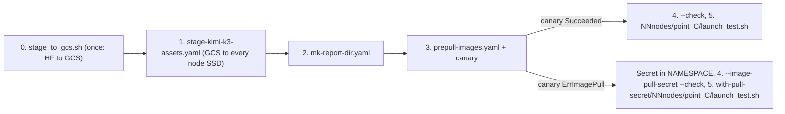

> Site-specific names, paths and addresses are replaced with `<placeholders>`.

# Kimi K3 on GKE (GB300 NVL72 / A4X-max) — NVIDIA drop v1.0.3

This is the GKE port of the NVIDIA MLPerf Endpoints Kimi K3 recipe from drop **v1.0.3**. It
serves with **TensorRT-LLM (`1.3.0rc25.post1`) + Dynamo (`1.6.0.dev20260918`)** in disaggregated
mode (TensorRT-LLM prefill and decode workers behind `dynamo.frontend`, with an `etcd` + `nats-server`
control plane on node 0 and DSpark speculative decoding on the decode workers). It covers all 16
GB300 points: **C12, C13, C16, C24, C32, C48, C64, C80, C192, C288, C384, C448, C512, C576,
C640, C1024**.

- Source: `nv-mlpinf-partner-partner-endpoints-v1.0.3/NVIDIA/src/kimi-k3/`. The port reads
  `configs/GB300-NVL72_GB300-288GB_aarch64x48_TRTLLM-Dynamo/point_<C>.yaml`, `disagg.yaml`,
  `setup.yaml`, `slurm_env.yaml`, `scripts/node.py`, `scripts/control_plane.json`,
  `scripts/swe_service.py`, `../sflow/tools/run_with_env.py`, `README.md` and
  `../../../dataset/README.md`.
- Method: [`../../SLURM_TO_GKE.md`](../../SLURM_TO_GKE.md).
- Key changes vs [`../../v1.0.2/kimi-k3/`](../../v1.0.2/kimi-k3/README.md):
  - **Serving stack:** standalone `trtllm-serve disaggregated` → **TensorRT-LLM + Dynamo**
    (`python3 -m dynamo.trtllm` for prefill, `/opt/k3-dynamo/helpers/dynamo_entry_v4.py` or
    `dynamo.trtllm` for decode, `/opt/k3-dynamo/{frontend,frontend-backlog}/bin/python3 -m dynamo.frontend`
    for the router, and `node.py control-plane` running `etcd` v3.6.5 + `nats-server` v2.11.9 on node 0).
  - **Images:** `kimi-k3-dynamo@sha256:985260a0...` (server) and `ghcr.io/mlcommons/endpoints@sha256:1523051b...`
    (client commit `d3c57f2`).
  - **Points:** `C8` (12 nodes) is replaced by **`C13`** (8 nodes, `1 ctx×8 + 3 gen×8`, 613 trajectories);
    `C32` issues `613` trajectories (1 pass) instead of `1226`.
  - **Frontend / client placement:** `FRONTEND_NODE == CLIENT_NODE` on every point (`2` on `C12..C80`,
    `4` on `C192..C1024`), so the client talks to `http://127.0.0.1:8000` over loopback.
  - **Native seed & reasoning parser:** Every point's `CLIENT_CONFIG` in the drop natively sets
    `model_params.seed: 9315206023656308754` and `dynamo.frontend` runs with `--reasoning-parser kimi_k3`
    and `--tool-call-parser kimi_k2`, so no GKE seed or reasoning-parser config injection is needed.

---

## 1. Run order



Run everything from this directory. Skip a step only if it is already done on this pool.

**0. Mirror the checkpoint to GCS (once per site).** Skip this step if the upload record
already exists (the checkpoint and draft are identical to v1.0.2):

```bash
gcloud storage cat <bucket>/staging-logs/kimi-k3-nvfp4-b2428a0b.verified.txt
```

**1. Stage onto every node.** Use [stage-kimi-k3-assets.yaml](stage-kimi-k3-assets.yaml) and
run the commands in its header (`apply`, `rollout status --timeout=180m`, `logs`, `delete`).
- Nodes already staged by v1.0.2's `stage-kimi-k3-assets.yaml` already hold the identical
  checkpoint, draft, and dataset and pass immediately.
- Every server and frontend pod checks `.sflow-staged` against the pinned revision (D5).
- The dataset sha256 is checked by the benchmark task (D6).

**2. Create the durable report and control-plane cache directories.** Use [mk-report-dir.yaml](mk-report-dir.yaml)
and paste the commands from its header (`POOL=…`, `sed | kubectl apply`, `rollout status`, `delete`).
- It creates `<node-local-ssd>/kimi-reports` (mode 1777) and
  `<node-local-ssd>/model-cache/kimi-control-plane` (mode 0755) on every
  node of the pool.
- The benchmark writes the client's `report_dir` to `kimi-reports/<sflow run dir name>/` on
  `CLIENT_NODE` (n2 for C12–C80, n4 for C192–C1024).

**3. Pre-pull the images.** Use [prepull-images.yaml](prepull-images.yaml) and paste its header
block to pre-pull `kimi-k3-dynamo@sha256:985260a0...` and `endpoints@sha256:1523051b...` and run
the canary pod:
- **Canary `Succeeded`:** use the default tree (`8nodes/` and `12nodes/`, or `swe_acc/` / `swe_both/`).
- **Canary `ErrImagePull`:** keep `nv-gitlab-pull` in `${NAMESPACE}` and launch from
  `with-pull-secret/<N>nodes/point_<C>/` (or `with-pull-secret/swe_<mode>/<N>nodes/point_<C>/`).

**4. Confirm the recipes still match the drop.** This step writes nothing and uses no network:

```bash
PYTHONDONTWRITEBYTECODE=1 <workdir>/sflow_workspace/.venv/bin/python3 -B generate_point_recipes.py --check
# canary ErrImagePull only:
PYTHONDONTWRITEBYTECODE=1 <workdir>/sflow_workspace/.venv/bin/python3 -B generate_point_recipes.py --image-pull-secret --check
```

**5. Run one point at a time, C24 first.**

```bash
export NAMESPACE=REPLACE-WITH-NAMESPACE NODEPOOL=REPLACE-WITH-NODE-POOL
cd 8nodes/point_24 && mkdir -p sflow_output
setsid nohup ./launch_test.sh > sflow_output/launch-$(date -u +%Y%m%dT%H%M%SZ).log 2>&1 &
```

---

## 2. Points and topology

Topology and trajectory counts come from the drop and are asserted against the generator's
`EXPECTED` table.

| Point | Recipe | Nodes / GPUs | Prefill (ctx) | Decode (gen) | Control plane | Frontend / client | Trajectories (passes) |
|---|---|---|---|---|---|---|---:|
| C12 | [12nodes/point_12](12nodes/point_12/kimi_k3_gke_disagg_point12.yaml) | 12 / 48 | 1 × 8 GPU TP8 EP8, n0–1 | 5 × 8 GPU Helix CP8 EP8, DSpark 5, n2–11 | n0 | n2 / n2 | 613 (1) |
| C13 | [8nodes/point_13](8nodes/point_13/kimi_k3_gke_disagg_point13.yaml) | 8 / 32 | 1 × 8 GPU TP8 EP8, n0–1 | 3 × 8 GPU Helix CP8 EP8, DSpark 3, n2–7 | n0 | n2 / n2 | 613 (1) |
| C16 | [8nodes/point_16](8nodes/point_16/kimi_k3_gke_disagg_point16.yaml) | 8 / 32 | 1 × 8 GPU TP8 EP8, n0–1 | 3 × 8 GPU Helix CP8 EP8, DSpark 3, n2–7 | n0 | n2 / n2 | 613 (1) |
| C24 | [8nodes/point_24](8nodes/point_24/kimi_k3_gke_disagg_point24.yaml) | 8 / 32 | 1 × 8 GPU TP8 EP8, n0–1 | 3 × 8 GPU Helix CP8 EP8, DSpark 3, n2–7 | n0 | n2 / n2 | 613 (1) |
| C32 | [8nodes/point_32](8nodes/point_32/kimi_k3_gke_disagg_point32.yaml) | 8 / 32 | 1 × 8 GPU TP8 EP8, n0–1 | 3 × 8 GPU Helix CP8 EP8, DSpark 3, n2–7 | n0 | n2 / n2 | 613 (1) |
| C48 | [8nodes/point_48](8nodes/point_48/kimi_k3_gke_disagg_point48.yaml) | 8 / 32 | 1 × 8 GPU TP8 EP8, n0–1 | 3 × 8 GPU Helix CP8 EP8, DSpark 3, n2–7 | n0 | n2 / n2 | 1,226 (2) |
| C64 | [8nodes/point_64](8nodes/point_64/kimi_k3_gke_disagg_point64.yaml) | 8 / 32 | 1 × 8 GPU TP8 EP8, n0–1 | 3 × 8 GPU Helix CP8 EP8, DSpark 3, n2–7 | n0 | n2 / n2 | 1,839 (3) |
| C80 | [8nodes/point_80](8nodes/point_80/kimi_k3_gke_disagg_point80.yaml) | 8 / 32 | 1 × 8 GPU TP8 EP8, n0–1 | 3 × 8 GPU Helix CP8 EP8, DSpark 3, n2–7 | n0 | n2 / n2 | 1,839 (3) |
| C192 | [12nodes/point_192](12nodes/point_192/kimi_k3_gke_disagg_point192.yaml) | 12 / 48 | 16 × 1 GPU DWDP16, n0–3 | 2 × 16 GPU Helix CP16 EP16, DSpark 3, n4–11 | n0 | n4 / n4 | 3,065 (5) |
| C288 | [12nodes/point_288](12nodes/point_288/kimi_k3_gke_disagg_point288.yaml) | 12 / 48 | 16 × 1 GPU DWDP16, n0–3 | 2 × 16 GPU Helix CP16 EP16, DSpark 3, n4–11 | n0 | n4 / n4 | 4,904 (8) |
| C384 | [12nodes/point_384](12nodes/point_384/kimi_k3_gke_disagg_point384.yaml) | 12 / 48 | 16 × 1 GPU DWDP16, n0–3 | 2 × 16 GPU Helix CP16 EP16, DSpark 3, n4–11 | n0 | n4 / n4 | 4,291 (7) |
| C448 | [8nodes/point_448](8nodes/point_448/kimi_k3_gke_disagg_point448.yaml) | 8 / 32 | 16 × 1 GPU DWDP16, n0–3 | 1 × 16 GPU TP16 EP16 attention-DP, DSpark 3, n4–7 | n0 | n4 / n4 | 4,291 (7) |
| C512 | [8nodes/point_512](8nodes/point_512/kimi_k3_gke_disagg_point512.yaml) | 8 / 32 | 16 × 1 GPU DWDP16, n0–3 | 1 × 16 GPU TP16 EP16 attention-DP, DSpark 3, n4–7 | n0 | n4 / n4 | 4,904 (8) |
| C576 | [8nodes/point_576](8nodes/point_576/kimi_k3_gke_disagg_point576.yaml) | 8 / 32 | 16 × 1 GPU DWDP16, n0–3 | 1 × 16 GPU TP16 EP16 attention-DP, DSpark 3, n4–7 | n0 | n4 / n4 | 4,904 (8) |
| C640 | [8nodes/point_640](8nodes/point_640/kimi_k3_gke_disagg_point640.yaml) | 8 / 32 | 16 × 1 GPU DWDP16, n0–3 | 1 × 16 GPU TP16 EP16 attention-DP, DSpark 3, n4–7 | n0 | n4 / n4 | 4,904 (8) |
| C1024 | [8nodes/point_1024](8nodes/point_1024/kimi_k3_gke_disagg_point1024.yaml) | 8 / 32 | 16 × 1 GPU DWDP16, n0–3 | 1 × 16 GPU TP16 EP16 attention-DP, DSpark 3, n4–7 | n0 | n4 / n4 | 4,904 (8) |

---

## 3. Provenance

| Asset | Pin | Source |
|---|---|---|
| Server image | `kimi-k3-dynamo@sha256:985260a01a2dfb66bdd0c68f0bd482e78f69c1b101120c7341782d101e2602a4 (built from public sources via `src/trtllm-dynamo-gke/container/build.sh`)` (TensorRT-LLM `1.3.0rc25.post1`, Dynamo `1.6.0.dev20260918`; tag `candidate-backlog-03bb2f90fc43-r1`) | drop `slurm_env.yaml` (enroot `#` → registry `/`) |
| Client image | `ghcr.io/mlcommons/endpoints@sha256:1523051b141437b25083924d6428082f435713516eee71c54ae207b393900b2d` (commit `d3c57f2`) | drop `slurm_env.yaml` `CLIENT_IMAGE` |
| Model | `nvidia/Kimi-K3-NVFP4 @ b2428a0b83a8b712ff2e1a8448a103d4175341f1`: 116 files, 1,610,039,528,856 B; `config.json` git-sha1 `0e4b41bbe8d1e6ca545853ec60f12601a84e5fe5` is checked in every server and frontend pod | drop README "Model and data" |
| Draft | `RadixArk/Kimi-K3-DSpark @ 3c5bac301d9cf392706189d82ed947feca6c2f0f`: 7 files, 4,498,618,073 B | drop README |
| Dataset | `mlperf_agentic_inference_dataset.jsonl` (mounted as `/data/agentic_combined_v6.jsonl`), sha256 `1beb24c882122df96571cf11b390acbea388944038bc55c78b891475459014ae` | `dataset/README.md` |
| Control plane | `etcd` `v3.6.5` (`linux-arm64`) and `nats-server` `v2.11.9` (`linux-arm64`), sha256-verified by `scripts/node.py` against `scripts/control_plane.json` and cached in `CONTROL_PLANE_DIR` | drop `scripts/control_plane.json` |
| sflow | Drop pins `nv-sflow@b8afb5b86b3f46d9fa771531990fc7afaefc69b9`; rendered and dry-run with local `0.3.1.dev13+gc98458cc9` (`<workdir>/sflow_workspace/.venv`) | drop README / local venv |

---

## 4. Files and generator

| File | What |
|---|---|
| [generate_point_recipes.py](generate_point_recipes.py) | Generates every recipe and launcher from the drop; `--check` verifies them. No network, no subprocess, fails closed. |
| `8nodes/point_<C>/`, `12nodes/point_<C>/` | GENERATED perf recipes (`kimi_k3_gke_disagg_point<C>.yaml` and `launch_test.sh`). Do not hand-edit. |
| `with-pull-secret/<N>nodes/point_<C>/` | GENERATED opt-in variant (`--image-pull-secret`), only for a canary `ErrImagePull`. |
| `swe_acc/<N>nodes/point_<C>/`, `swe_both/<N>nodes/point_<C>/` | GENERATED opt-in SWE-bench recipes (`--swe acc` / `--swe both`), plus `with-pull-secret/swe_<mode>/`. |
| [swe/](swe/README.md) | GKE rootless Enroot SWE-bench service (`run_swe_sweep.sh`, `swe-host-entry.sh`, `pilot/swe_pilot.py`, `tests/`). |
| [mk-report-dir.yaml](mk-report-dir.yaml) | DaemonSet that creates the durable `kimi-reports` and `kimi-control-plane` hostPaths on every node. |
| [stage_to_gcs.sh](stage_to_gcs.sh) | Startup script for a GCE VM that mirrors the checkpoint from HF to GCS, hash-verified before upload. |
| [stage-kimi-k3-assets.yaml](stage-kimi-k3-assets.yaml) | DaemonSet that copies from GCS to every node's SSD and verifies hashes before writing `.sflow-staged`. |
| [prepull-images.yaml](prepull-images.yaml) | Image pre-pull DaemonSet, with the temporary-Secret block and the canary in its header. |
| [POINTS.md](POINTS.md) | Per-point topology, cost, checker bands and candidate point sets. |

Regenerate and verify:

```bash
PY="env PYTHONDONTWRITEBYTECODE=1 <workdir>/sflow_workspace/.venv/bin/python3 -B"
$PY generate_point_recipes.py                           # rewrite all 16 default perf points
$PY generate_point_recipes.py --image-pull-secret       # rewrite with-pull-secret perf tree
$PY generate_point_recipes.py --swe acc                 # rewrite swe_acc tree
$PY generate_point_recipes.py --swe both                # rewrite swe_both tree
$PY generate_point_recipes.py --image-pull-secret --swe acc
$PY generate_point_recipes.py --image-pull-secret --swe both
$PY generate_point_recipes.py --check                   # verify default perf tree
$PY generate_point_recipes.py --image-pull-secret --check
$PY generate_point_recipes.py --swe acc --check
$PY generate_point_recipes.py --swe both --check
$PY generate_point_recipes.py --image-pull-secret --swe acc --check
$PY generate_point_recipes.py --image-pull-secret --swe both --check
$PY generate_point_recipes.py --dump-scripts DIR        # task scripts for external bash -n
```

---

## 5. Deviations from the drop

The model and workload configuration is verbatim from the v1.0.3 drop (`point_<C>.yaml`, `disagg.yaml`, `setup.yaml`, `slurm_env.yaml`, and helpers `node.py`, `control_plane.json`, `run_with_env.py`). The GKE layer lives only in `generate_point_recipes.py`:

```text
D1  Launcher: srun + pyxis (operators host/server/client, --segment=SEGMENT_NODES,
    mpi: pmix) -> backend `cluster` (kubernetes; host network/IPC; device-plugin
    GPUs; rdma: disable; compute_domain create = the MNNVL domain) and operators
    server_ctx/server_gen (k8s_mpi, privileged, sshd on 2222, ensure_sshd
    apt-installs openssh-server at pod start), server_cpu (k8s, not privileged:
    preflight + control_plane + frontend; frontend symlinks
    /usr/local/cuda/compat/lib.real/libcuda.so.1 over the image's 0-byte
    /usr/lib/aarch64-linux-gnu/libcuda.so.620.43 and guards flashinfer_utils.py's
    import-time get_device_capability() when no GPU is mounted), client (k8s:
    client_gate + client_preflight + benchmark). Images by digest, imagePullPolicy
    IfNotPresent (pre-pulled; see README).
D2  Server launch: `exec trtllm-llmapi-launch env ... python3 -m dynamo.trtllm ...`
    (or `python3 /opt/k3-dynamo/helpers/dynamo_entry_v4.py ...`) ->
    `exec mpirun -np <CTX_GPUS|GEN_GPUS> --allow-run-as-root /tmp/kimi-rank-env.sh
    <role> trtllm-llmapi-launch env UCX_NET_DEVICES="$UCX_NET_DEVICES"
    UCX_TLS="$UCX_TLS" python3 ...`. Everything from `python3 ` onward is the
    drop's exact text.
D3  Cache dirs & Dynamo namespace:
    /tmp/kimi-${SLURM_JOB_ID}-${SLURM_STEP_ID}-${SLURM_PROCID:-0} ->
    /tmp/kimi-<role>-${SFLOW_REPLICA_INDEX}-${KIMI_RANK:-0}, and
    DYN_NAMESPACE="k3-${SLURM_JOB_ID}" ->
    DYN_NAMESPACE="k3-$(basename "${SFLOW_WORKFLOW_OUTPUT_DIR}")".
    /tmp/kimi-rank-env.sh redoes the per-rank cache-dir exports, unsets NGC 26.08
    gIB plugin exports, restores full-node CPU affinity, sets
    garbage_collection_threshold:0.75 on PYTORCH_CUDA_ALLOC_CONF, and sets a
    disjoint per-pod /proc/sys/kernel/ns_last_pid base so UCX's remote VMM cache
    never collides across containers.
D4  ${SFLOW_TOOLS}/${RECIPE} (fs:// into a repo checkout on shared storage) ->
    run_with_env.py, node.py, control_plane.json embedded verbatim as <workdir>
    artifacts; scripts export SFLOW_TOOLS/RECIPE to their in-pod directories.
    control_plane caches verified etcd v3.6.5 and nats-server v2.11.9 under
    CONTROL_PLANE_DIR on node 0's local SSD.
D5  Model/draft: container mounts MODEL_PATH:/models/kimi-k3:ro and
    DRAFT_PATH:/models/kimi-k3-dspark:ro -> node-local SSD hostPaths (fs://) plus
    atomic symlinks /models/kimi-k3 and /models/kimi-k3-dspark in every server and
    frontend pod, and /models/kimi-k3 in every client pod. Each server/frontend pod
    exits unless both dirs hold config.json and a .sflow-staged marker equal to the
    pinned revision (stage-kimi-k3-assets.yaml) and the model's config.json is
    nvidia/Kimi-K3-NVFP4@b2428a0b (git sha1).
D6  Dataset: client container mount DATASET_PATH:/data/agentic_combined_v6.jsonl:ro
    -> fs:// on DATASET_DIR plus symlink /data/agentic_combined_v6.jsonl ->
    ${DATASET_PATH} in every client task. The benchmark refuses to start unless the
    file's sha256 matches dataset/README.md.
D7  Dynamo control plane & discovery: control_plane runs `node.py control-plane` on
    node 0 (HEAD_NODE_IP:2379 etcd + nats://HEAD_NODE_IP:4222); prefill, decode, and
    frontend share DYN_NAMESPACE="k3-$(basename "${SFLOW_WORKFLOW_OUTPUT_DIR}")" and
    export DYN_SYSTEM_HOST/DYN_TCP_RPC_HOST/DYN_TCP_RESPONSE_STREAM_HOST/DYN_EVENT_PLANE_HOST="$(hostname -i)"
    so Dynamo's ip_resolver advertises the node's eth0 IPv4 instead of GKE's
    <ip> link-local metadata address on lo.
D8  UCX_NET_DEVICES=eth0 and UCX_TLS=cuda_ipc,cuda_copy,sm,self,tcp forced after the
    drop env eval (the Slurm drop sets UCX_TLS=all / UCX_CUDA_IPC_ENABLE_MNNVL=n for
    InfiniBand on C12-C80/C1024 and eth0 on C192-C640).
D9  GKE env block in the server pods (see GKE_SERVER_ENV): MNNVL NCCL, eth0 socket
    ifnames, Open MPI ob1/tcp on eth0, PRTE binding policy none, NGC 26.08
    /opt/gcp/nccl-plugins/lib64 disabled so /etc/shinit_v2 cannot force NCCL_NET=gIB,
    UCX_CUDA_IPC_ENABLE_MNNVL=y, UCX_RNDV_SCHEME=put_zcopy, UCX_MEMTYPE_CACHE=n,
    TLLM_LOG_LEVEL=INFO.
D10 hang_detector.py, _util.py, and kv_cache_manager_v2.py patched in-pod (atomic;
    exits if the pattern is not found) so TRTLLM_HANG_DETECTOR_TIMEOUT=3600 replaces
    the 300 s default, TRTLLM_TORCH_MEM_SAFETY_MARGIN_MB=4096 replaces
    _adjust_torch_mem_fraction's 32 MiB margin, and the mirrored draft KV cache
    manager sets max_util_for_resume=1.0 in _build_base_config.
D11 Best-effort sysctl socket-buffer raise in the server pods.
D12 Fabric: setup.yaml `fabric` (one srun per node) + `node.py check ... preflight` ->
    the drop's `node.py probe` fabric line runs in every server pod and prints
    KIMI_FABRIC; the ComputeDomain admits only one IMEX domain. The preflight task
    keeps the drop's arithmetic asserts and server-configs snapshot.
D13 Client: report_dir /results/report -> ${REPORT_DIR} (node SSD, survives pod loss)
    and settings.metrics_tokenizer_workers: 32 (post-run tokenization speed only).
    Benchmark: client import check, dataset sha256 + tokenizer checks, REPORT_DIR
    printed first, small-file report mirror into the sflow output.
D14 Workflow name kimi_k3_trtllm_v1_0_3_gke_c<C> (drop: kimi-k3-dynamo).
Unchanged: server/env YAMLs, probes, timeouts, ports, depends_on, Dynamo router/decode flags.
```

## Public Server Container Build (`src/trtllm-dynamo-gke/container/build.sh`)

The `kimi-k3-dynamo` server image (`TensorRT-LLM v1.3.0rc25.post1` + `Dynamo v1.6.0.dev20260918`, digest `sha256:985260a01a2dfb66bdd0c68f0bd482e78f69c1b101120c7341782d101e2602a4`) is built entirely from public sources using `src/trtllm-dynamo-gke/container/build.sh`:
- **TensorRT-LLM:** public branch [`feat/k3_26.08`](https://github.com/NVIDIA/TensorRT-LLM/tree/feat/k3_26.08) at commit [`45c5ae4150e51df678b2435457ff39679e8fd8d6`](https://github.com/NVIDIA/TensorRT-LLM/commit/45c5ae4150e51df678b2435457ff39679e8fd8d6)
- **Dynamo wheels:** `ai-dynamo==1.6.0.dev20260918` and `ai-dynamo-runtime==1.6.0.dev20260918` from PyPI
- **Dynamo frontend:** built from [`ai-dynamo/dynamo` commit `a9792dbe2402d379232f0aa88eb647cddb78dcab`](https://github.com/ai-dynamo/dynamo/tree/a9792dbe2402d379232f0aa88eb647cddb78dcab) and `dynamo-renderer` crate `v5.2.0` from crates.io, patched with `src/trtllm-dynamo-gke/dynamo/kimi-k3.patch` (`kimi-k3-build.patch`).
